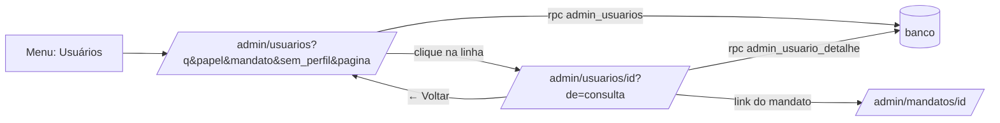

# Aba Usuários no Painel Admin Design

**Spec**: `.specs/features/admin-usuarios/spec.md`
**Status**: Draft

---

## Architecture Overview

Duas funções de leitura no banco (`admin_usuarios` e `admin_usuario_detalhe`), duas páginas novas do `/admin` (`/admin/usuarios` e `/admin/usuarios/[id]`) e um item novo no menu. Tudo segue o padrão do `painel-admin`: `security definer`, `search_path` vazio, checagem de `equipe_legisla` dentro da função, sem `execute` para `anon`, cliente REST/RPC já existente (`useAdmin().api`). A busca, os filtros e a paginação rodam no servidor; o estado da lista vive na query string da URL, o que mantém a busca ao voltar do detalhe.

Decisões:

- **Funções que devolvem `jsonb`**, não `table`: a lista traz os mandatos de cada pessoa aninhados e o total da consulta no mesmo retorno, em uma chamada só.
- **Sem extensão `unaccent`**: o PGlite dos testes não a tem. Uma função `private.sem_acento(text)` com `translate` cobre as vogais acentuadas e o `ç`, no banco e nos testes.
- **Estado na URL**: `q`, `papel`, `mandato`, `sem_perfil`, `pagina`. O detalhe recebe a consulta da lista em `de=` (codificada) e o link "← Voltar para Usuários" a reconstrói.
- **Detalhe inexistente** devolve `null` (dado, não exceção); a página mostra "Pessoa não encontrada.".
- **Só leitura**: as duas funções são `stable` e não gravam nada.

---

## Code Reuse Analysis

### Existing Components to Leverage

| Component | Location | How to Use |
| --------- | -------- | ---------- |
| `Casca`, `Sessao`, `useAdmin` | `plataforma/app/admin/_componentes/` | Menu, papel e cliente da API; o `Tela` ganha `'usuarios'` |
| Página de lista com filtros e paginação | `plataforma/app/admin/page.tsx` (Mandatos) | Padrão de tabela, busca e filtros |
| Página de detalhe | `plataforma/app/admin/mandatos/[id]/page.tsx` | Padrão de detalhe com "voltar" |
| `semAcento`, `partesBrasilia`, `mensagemDe` | `plataforma/lib/admin/` | Texto sem acento, datas de Brasília e mensagem de erro padrão |
| `opcoes.ts` | `plataforma/lib/perfil/opcoes.ts` | Rótulos de gênero, raça e atuação |
| Padrão de função admin | `20261105120000_admin_equipe.sql` | `security definer`, erro 42501, grants |
| `v_admin_mandatos` | `20261105130000_admin_leitura.sql` e `20261105140000_admin_mandatos_gestao.sql` | Opções do filtro de mandato |
| `sql-ambiente.ts` | `plataforma/tests/sql-ambiente.ts` | PGlite; a simulação de `auth.users` ganha `last_sign_in_at` |
| `mocka` do admin | `plataforma/e2e/admin-api.ts` | Mock do Supabase nos e2e |

---

## Components

### Migration `20261110120000_admin_usuarios.sql`

- `private.sem_acento(text)`: minúsculas e sem acento (`translate`).
- `public.admin_usuarios(p_busca text, p_papel text, p_mandato uuid, p_sem_perfil boolean, p_limite int, p_offset int)` retorna `jsonb` `{ total, linhas: [{ id, nome, email, criado_em, ultimo_acesso, sem_perfil, equipe_papel, mandatos: [{ id, nome, papel, arquivado }] }] }`. Exige `private.eh_legisla()` (erro 42501, "Você não tem permissão para esta ação."). `p_papel`: `coordenacao`, `assessoria`, `leitura` (papel em algum mandato) ou `legisla` (está em `equipe_legisla`). Limite fora de 1 a 100 vira 25. Busca cortada em 100 caracteres. Ordem: `last_sign_in_at desc nulls last, email asc`.
- `public.admin_usuario_detalhe(p_user uuid)` retorna `jsonb` ou `null`: `{ id, nome, email, criado_em, ultimo_acesso, equipe_papel, perfil: { nome, nascimento, genero, raca, telefone, atua, tempo } | null, consentimento: { versao, aceito_em } | null, mandatos: [{ id, nome, cargo, uf, papel, arquivado }] }`.
- `revoke execute ... from public, anon`; `grant execute ... to authenticated`.

### `lib/admin/usuarios.ts` (funções puras, `node --test`)

`lerConsulta(searchParams)` e `montaConsulta(estado)` (URL ↔ estado, com cortes e padrões), `rotuloUltimoAcesso(iso | null)`, `rotuloMandato(m)` (nome, papel, "(arquivado)"), `marcaPessoa(linha)` ("Sem perfil" ou papel na equipe), `rotulosPerfil(perfil)` (gênero, raça, atuação em texto, nascimento `dd/mm/aaaa`, telefone formatado), `paginas(total, pagina)`.

### Páginas (e2e Playwright, Supabase interceptado)

- `app/admin/usuarios/page.tsx`: tabela, busca, filtros, paginação, estados vazio, erro e carregando. Layout legível em 400 px.
- `app/admin/usuarios/[id]/page.tsx`: cabeçalho, perfil, consentimento, mandatos com link; estados "Pessoa não encontrada." e erro.
- `Casca.tsx`: `Tela` ganha `'usuarios'` e o `MENU` o item "Usuários" entre Mandatos e Analytics.

---

## Error Handling Strategy

| Error Scenario | Handling | User Impact |
| -------------- | -------- | ----------- |
| Sem permissão (conta de mandato ou `anon`) | O banco recusa com 42501 | Mensagem de erro padrão do painel |
| Falha de rede ou 5xx | Mensagem padrão (`mensagemDe`) e "Tentar de novo" | O resto do painel segue |
| 401 | O wrapper já renova a sessão uma vez; sem sucesso volta à entrada | Entrar de novo |
| Id inexistente | Função devolve `null` | "Pessoa não encontrada." |
| Consulta inválida na URL (`pagina` negativa, `papel` desconhecido) | `lerConsulta` volta ao padrão | Lista normal |

---

## Risks & Concerns

| Risk | Impacto | Mitigação |
| ---- | ------- | --------- |
| A função expõe raça, gênero e nascimento | Dado sensível sob LGPD | Só `equipe_legisla`, só no detalhe, sem exportar; o histórico de leitura fica como pendência registrada |
| `last_sign_in_at` não existe na simulação de `auth.users` dos testes | Teste de SQL não roda | A tarefa 1 acrescenta a coluna à simulação em `sql-ambiente.ts` |
| Busca com `ilike` sem índice | Lenta com muitas contas | Volume atual é de dezenas; revisar se passar de milhares |
| Acento fora do mapa do `translate` | Busca não acha | Cobre vogais acentuadas e `ç`; documentado |

---

## Tech Decisions (only non-obvious ones)

| Decision | Choice | Rationale |
| -------- | ------ | --------- |
| Formato do retorno | `jsonb` aninhado | Uma chamada traz linhas, mandatos e total |
| Acento na busca | `translate` próprio | `unaccent` não existe no PGlite |
| Estado da lista | Query string | Volta do detalhe mantém busca e filtros sem estado global |
| Último acesso | `last_sign_in_at` | É o dado que o Supabase guarda; não é atividade no Guia |
