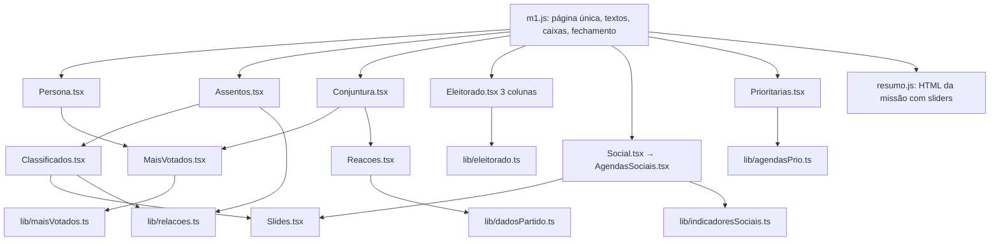

# Reestruturação da Missão 1 Design

**Spec**: `.specs/features/m1-reestruturacao/spec.md`
**Status**: Draft

Caminhos relativos a `plataforma/`. Decisões ativas do `.specs/STATE.md` que este design cumpre: **AD-003** (texto e ganchos novos só em `public/legacy/m1.js`, nunca em `conteudo.js`) e **AD-004** (regra de negócio em `lib/` como função pura, a ilha só chama e grava pela ponte). Nenhuma decisão é substituída.

---

## Architecture Overview

O Guia continua legado + ilhas. A reestruturação mexe em três camadas, nesta ordem de risco:

1. **`lib/` (puro, testado com `node --test`)**: categorias de relação, registro de eleitorado, municípios mais votados, indicadores sociais por agenda, agendas prioritárias, dados selecionáveis do partido.
2. **`ilhas/` (React)**: ilhas existentes encolhem (Persona, Assentos, Conjuntura, Eleitorado, Social) e entram componentes novos (carrossel, cartões de município, reações, agendas prioritárias).
3. **`public/legacy/m1.js` (à mão)**: página única por etapa, textos novos, caixas novas, fechamento com botão de HTML. É a única camada que toca o Guia original.



### Abordagem escolhida (e as descartadas)

| Opção | Resumo | Veredito |
| ----- | ------ | -------- |
| **A. Editar as ilhas no lugar e extrair só o que é novo** | Remover mapas e blocos das ilhas atuais; criar componentes novos para carrossel, cartões e seletores; regra em `lib/` | **Escolhida**. Mantém `D.*`, ponte, Resumo e testes e2e atuais; o risco fica nas remoções |
| B. Ilhas novas ao lado das atuais e trocar o `data-ilha` | Duplica Persona/Assentos/Conjuntura por um tempo | Descartada: dobra o código que o Resumo e o admin já leem |
| C. Reescrever a Missão 1 numa rota React fora do legado | Página única nativa | Descartada: foge do padrão do projeto (AD-003) e quebra a rota de dados e a aba Resumo |

---

## Code Reuse Analysis

### Existing Components to Leverage

| Component | Location | How to Use |
| --------- | -------- | ---------- |
| `Guia.modo = 'tudo'` | `public/legacy/guia.js:3,42-70` | Já renderiza todos os passos numa página sem anterior/avançar; a Missão 1 passa a abrir sempre nesse modo (PAG-01, PAG-03) |
| `Guia.faixaEtapas`, `ETAPAS` | `public/legacy/m1.js:110-132` | Mantidos como estão (PAG-02) |
| Mecanismo `caixas` / `injeta` | `public/legacy/m1.js:49-81` | Estender `caixa()` para N caixas de conquista e para a caixa `m1.q6` no fim da página |
| `Resumo.ex` extra | `public/legacy/m1.js:134-150` | Acrescentar as chaves novas à lista do Resumo (GER-02) |
| `ResumoIlhas.html(ilha)` | `public/legacy/novos.js:183-210` | Ponto onde o Resumo troca as listas de aliados/opositores/potenciais pelo resumo de LEG-12 |
| `StatusBotoes`, `Marca`, `ROT_REL*`, `AJUDA_REL`, `InfoRelacao` | `ilhas/pecas.tsx:85-115` | Passam a ler as 5 categorias de `lib/relacoes.ts` |
| `Hemiciclo`, `Foto`, `Chip`, `Info`, `useCarga` | `ilhas/pecas.tsx` | Reaproveitados sem mudança nos cartões novos |
| `votos-mun` | `app/api/votos-mun/route.ts` | Fonte dos 5 municípios mais votados; sem mudança na rota |
| Loaders de dados | `lib/dados.ts` (`carregaMun`, `carregaGeo`, `carregaExecUF`, `carregaFiliadosUF`) | Alimentam os cartões do partido |
| `AGENDAS`, `FAIXAS`, `faixaDe`, `carregaCatalogo`, `carregaIndicador` | `lib/agendas.ts:17-85` | Base dos cartões sociais; as 13 agendas e as faixas já existem |
| Lista `GRUPOS`, `TIPOS`, `mesclagem por texto sem acento` | `ilhas/Eleitorado.tsx:14-19,73-83` | Movidos para `lib/eleitorado.ts` (puro) e reusados |
| Padrão de teste do legado em `vm` | `tests/legado-m1.test.ts:1-50` | Novos testes de `m1.js` seguem o mesmo molde |
| Padrão e2e | `e2e/m1-etapas.spec.ts`, `e2e/guia-real.ts` (`abreGuia`) | Novos e2e seguem o molde |

### Integration Points

| System | Integration Method |
| ------ | ------------------ |
| Estado do mandato | Só `D.*` pela ponte (`useLegado`, `bump`). Campos novos: `D.agendasPrio`, `D.conj2.reacoes`, `D.campos['m1.q3c1'..'m1.q3c3']`. Tipados em `lib/types.ts` e em `Legado` (`ilhas/ponte.tsx:48-70`) |
| Supabase | Nenhuma migration: tudo vive em `mandatos.dados` (jsonb). O catálogo `exercicios_guia` não muda (os 4 exercícios continuam) |
| Registro de uso | As ilhas novas reaproveitam as chaves existentes de `funcionalidadeDe` (`lib/uso.ts`); nenhuma funcionalidade nova é medida |
| Resumo e exportação | `Baixar.missao(1)` (`public/legacy/resumo.js`) ganha uma variante com script inline para os carrosséis (FEC-02, FEC-03) |

---

## Components

### lib/relacoes.ts (novo)

- **Purpose**: As 5 categorias de relação, seus rótulos e o texto-resumo.
- **Location**: `lib/relacoes.ts`
- **Interfaces**:
  - `CATEGORIAS: { k: Status; rot: string; def: string }[]` - na ordem da Alana: `aliado` "Aliado", `aliado_concorrente` "Aliado, mas concorrente", `concorrente` "Oponente", `oponente_concorrente` "Oponente e concorrente", `potencial` "Indefinida"
  - `rotulo(k: Status): string`
  - `contagem(relacoes: Record<string, Relacao>): Partial<Record<Status, number>>`
  - `resumoTexto(relacoes): string` - "Você tem 20 Aliados; 5 Aliados, mas concorrentes; …", só categorias com ao menos 1 (LEG-12); vazio se não há classificação
- **Dependencies**: `lib/types.ts`
- **Reuses**: `ROT_REL*` de `ilhas/pecas.tsx` (passam a delegar a este módulo)

### lib/eleitorado.ts (novo)

- **Purpose**: Regras puras do registro de expectativas do eleitorado.
- **Location**: `lib/eleitorado.ts`
- **Interfaces**:
  - `COLUNAS: { k: TipoEl; titulo: string; rotuloForm: string; exemplo: string; cor: string; tags: boolean }[]`
  - `GRUPOS: string[]` (as 16 tags)
  - `adiciona(itens: ItemEl[], tipo: TipoEl, texto: string, id: string): { itens: ItemEl[]; erro?: 'vazio' | 'repetido' }` - texto aparado; repetido = mesmo texto sem acento e sem maiúscula no mesmo tipo (ELE-08); item novo grava `muns: []` (ELE-05)
  - `remove(itens, id): ItemEl[]`
- **Dependencies**: `lib/format.ts` (`semAcento`), `lib/types.ts`
- **Reuses**: a lógica de duplicidade hoje dentro de `ilhas/Eleitorado.tsx:77`. A mesclagem de municípios some

### lib/maisVotados.ts (novo)

- **Purpose**: Dos votos por município (`/api/votos-mun`) devolver os 5 mais votados.
- **Location**: `lib/maisVotados.ts`
- **Interfaces**:
  - `cincoMais(mun: Record<string, [number, number]>, nomes: Map<string,string>): { pos: number; cdi: string; nome: string; votos: number; pct: number }[]` - ordem decrescente de votos, desempate por nome, no máximo 5, `pct` = votos / votos válidos do município × 100 (PER-03)
- **Dependencies**: nenhuma
- **Reuses**: o formato `{ mun: { cdi: [votos, válidos] } }` de `MapaVotos.tsx` (a consulta já existe lá; o código de coleta é extraído para um hook `useVotosMun` em `ilhas/MaisVotados.tsx`)

### lib/dadosPartido.ts (novo)

- **Purpose**: Lista dos dados que a pessoa pode escolher em "Selecione 2 dados" e a frase gerada.
- **Location**: `lib/dadosPartido.ts`
- **Interfaces**:
  - `type DadoPartido = { id: string; nome: string; valor: string }`
  - `dadosSelecionaveis(placar, municipios): DadoPartido[]` - parlamentares, vereadores, prefeituras, filiados, posição nos Executivos, e por município: vereadores do partido, filiados e % de votos (PAR-10)
  - `frase(d: DadoPartido): string` - "Considerando {nome}: {valor}, o mandato deve" (PAR-11)
  - `defineReacao(reacoes: Reacao[], i: 0 | 1, dado: DadoPartido | null, texto: string): Reacao[]` - máximo 2 linhas (PAR-12)
- **Dependencies**: `lib/types.ts`

### lib/indicadoresSociais.ts (novo)

- **Purpose**: Montar os cartões de agenda com os números da UF e filtrar por faixa.
- **Location**: `lib/indicadoresSociais.ts`
- **Interfaces**:
  - `linhasDaAgenda(agenda: Agenda, cat: Catalogo, dados: Record<string, DadosIndicador | null>, uf: string): { indicador: string; ods: number; odsRot: string; nota: number }[]` - notas de ODS da agenda e indicadores (`agenda.ods` e `agenda.extras`), nota = `dados.uf[uf]`; indicador sem dado da UF é omitido
  - `filtraFaixa(linhas, faixa: string | 'todas')` - `faixaDe(nota).rot === faixa` (SOC-05)
  - `emSlides<T>(itens: T[], tam = 4): T[][]` (SOC-06)
- **Dependencies**: `lib/agendas.ts`
- **Reuses**: `opcoesIndicador`, `faixaDe`, `AGENDAS`

### lib/agendasPrio.ts (novo)

- **Purpose**: Escolha de até 3 agendas.
- **Location**: `lib/agendasPrio.ts`
- **Interfaces**: `alterna(atual: string[], id: string): { lista: string[]; erro?: 'cheio' }` - 4ª marcação não entra e devolve `cheio` (AGE-03); desmarcar remove (AGE-04); `faltam(lista): number` (AGE-02)

### ilhas/Slides.tsx (novo)

- **Purpose**: Carrossel genérico, 4 itens por slide, com Anterior/Próximo e "Slide X de Y".
- **Location**: `ilhas/Slides.tsx`
- **Interfaces**: `<Slides tam={4} itens={nodes} rotulo="…" />`; foco no botão após navegar; botões desabilitados nas pontas
- **Reuses**: `lib/indicadoresSociais.ts#emSlides`; usado por Classificados (tam 1 ou 3, a definir no cartão) e AgendasSociais (tam 4)

### ilhas/Classificados.tsx (novo)

- **Purpose**: Carrossel dos parlamentares classificados com filtros por categoria (LEG-08 a LEG-10).
- **Location**: `ilhas/Classificados.tsx`
- **Interfaces**: lê `D.relacoes` (só as de Casa, sem `mun`); filtro "Todas" + 5 categorias com contagem; cada cartão tem foto, nome, partido, Casa/UF, categoria e botões de `StatusBotoes`
- **Dependencies**: `Slides`, `lib/relacoes.ts`, `pecas.tsx`
- **Reuses**: `Foto`, `Chip`, `StatusBotoes`

### ilhas/MaisVotados.tsx (novo)

- **Purpose**: 5 cartões dos municípios mais votados (Persona, PER-03) e `useVotosMun` (também usado por Conjuntura).
- **Location**: `ilhas/MaisVotados.tsx`
- **Interfaces**: `<MaisVotados />` lê `D.tse` e o mandato; chama `/api/votos-mun` e `lib/maisVotados.ts`; estados: carregando, erro com a mensagem de PER-05, vazio; só candidatura 2026 (PER-04)
- **Reuses**: a chamada de `MapaVotos.tsx` (extrai a coleta para o hook)

### ilhas/Reacoes.tsx (novo)

- **Purpose**: As 2 linhas "Considerando [dado] o mandato deve [texto]" (PAR-09 a PAR-12).
- **Location**: `ilhas/Reacoes.tsx`
- **Interfaces**: recebe `DadoPartido[]` por prop (calculados na Conjuntura); `<select>` agrupado por tipo de dado; caixa de texto abre depois da escolha; grava `D.conj2.reacoes`
- **Dependencies**: `lib/dadosPartido.ts`

### ilhas/CartoesMunicipio.tsx (novo)

- **Purpose**: Cartões de município do partido: Placar, Força, Executivo (PAR-04 a PAR-08).
- **Location**: `ilhas/CartoesMunicipio.tsx`
- **Interfaces**: recebe a lista de `cincoMais` (ou o município de domicílio, PAR-08) e os dados já carregados na Conjuntura (`mun`, `fil`, `exUF`); cada cartão usa `CasaMunicipal` para vereadores e prefeito e o `PosExec` da seção Executivo (`D.conj2.prefExtra`)
- **Reuses**: `CasaMunicipal.tsx` (vereadores e prefeito), `sugere`/`POSICOES` de `Conjuntura.tsx:44-52`

### ilhas/AgendasSociais.tsx (novo)

- **Purpose**: Cartões por agenda temática com seletor de faixa e mini tabela (SOC-02 a SOC-08).
- **Location**: `ilhas/AgendasSociais.tsx`
- **Interfaces**: carrega `catalogo` + um arquivo por indicador via `carregaIndicador`; cartão = título da agenda, seletor "Todas/Muito baixo/…/Muito alto", tabela indicador × ODS × nota; slides de 4
- **Dependencies**: `Slides`, `lib/indicadoresSociais.ts`
- **Reuses**: `lib/agendas.ts`; os estilos `.tb` já usados nas ilhas

### ilhas/Prioritarias.tsx (novo)

- **Purpose**: Escolha das 3 agendas (AGE-01 a AGE-04).
- **Location**: `ilhas/Prioritarias.tsx`
- **Interfaces**: 13 botões `aria-pressed`, contador "faltam N", mensagem de AGE-03 em `role="status"`; grava `D.agendasPrio`

### Ilhas existentes que encolhem

| Ilha | Mudança | Requisitos |
| ---- | ------- | ---------- |
| `ilhas/Persona.tsx:278-293` | Remove `<MapaVotos>`; o ranking vira lista com `Chip` do partido e sem barras; insere `<MaisVotados />` depois do ranking. `MapaVotos.tsx` deixa de ser usado (arquivo removido na última task da fase, depois de conferir que nenhum import resta) | PER-01 a PER-05 |
| `ilhas/Assentos.tsx` | Remove o cartograma `SvgZoom` (UFs) e põe um `<select>` de escopo; abas "Câmara dos Deputados"; KPIs e barras de perfil logo abaixo dos filtros; paginação de 15 mantida; linha da própria liderança sem `StatusBotoes`; `RELACAO` e KPIs passam a ler `lib/relacoes.ts`; monta `<Classificados />` abaixo da tabela | LEG-01, 02, 06, 07 |
| `ilhas/pecas.tsx` | `StatusBotoes` mostra as 5 categorias; `Marca` ganha formas para `aliado_concorrente` (losango + contorno) e `oponente_concorrente` (triângulo + contorno); `AJUDA_REL` traz as definições da Alana | LEG-03, 04 |
| `ilhas/Conjuntura.tsx:458-565` | Remove a seção 2 (mapa, camadas, painel lateral e tabela de marcados) e deixa os cartões de cadeiras; seção 1 em cartões com borda; entram `<CartoesMunicipio />` e `<Reacoes />` depois dos dados; seções 3 e 4 ficam | PAR-02, 03, 14 |
| `ilhas/Municipio.tsx` | Deixa de ser montada na Missão 1 (a pergunta 2.3 some); o componente continua registrado em `ILHAS` para não quebrar o Resumo antigo | PAR-13 |
| `ilhas/Eleitorado.tsx` | Reescrito: 3 colunas, botão "+", formulário e tags; sem `MapaConjuntura`, busca nem seleção | ELE-01 a ELE-10 |
| `ilhas/Social.tsx` | Deixa de ser montada na Missão 1; `AgendasSociais` assume a pergunta 3.2. O componente e `D.social` permanecem para o Resumo e para dados salvos | SOC-02 a SOC-09 |
| `ilhas/Resumos.tsx` | `AssentosResumo` mostra o resumo de LEG-12 e as 5 categorias; `EleitoradoResumo` lista as 3 colunas sem município | LEG-13, ELE-11 |

### public/legacy/m1.js (à mão)

- **Purpose**: Ganchos do Guia para a nova estrutura.
- **Mudanças (cada uma é uma task)**:
  - **Página única**: `Guia.abrir` e `Guia.render` para `m.n === 1` forçam `Guia.modo = 'tudo'`, escondem o botão "Ver tudo de uma vez / Voltar ao passo a passo" e ignoram o número do passo da URL (PAG-01, 03, 04)
  - **Textos e caixas**: `q3.caixas` vira 3 caixas `m1.q3c1..c3` (+ `m1.q3b`); a caixa `m1.q4b` sai; `q6` perde a ilha `municipio` e vira texto + caixa `m1.q6` no fim da `m1.conjuntura`; `q7` troca a ilha por `eleitorado` de 3 colunas; `q8` troca a ilha `social` por `agendas-sociais` e ganha o passo `m1.q9` (`prioritarias`) (PER-06 a PER-09, PAR-09, 13, SOC-01 a 07, AGE-01)
  - **Resumo**: acrescenta `m1.q3c1..c3`, reações, agendas prioritárias e `m1.q6` (GER-02)
  - **Fechamento**: no fim de `m1.frag` mostra "Pronto!" e o botão "Gerar HTML do Mapa Político" (FEC-01, 02, 04)
  - **Fragilidades**: troca "Sistema" por "Sistemas" na lista base por override do item (FRA-02)

### public/legacy/resumo.js e novos.js

- `Baixar.mapaPolitico()` novo: monta o HTML da Missão 1 com `Resumo.missao(1)` mais os cartões de carrossel em HTML estático com um `<script>` inline de ~30 linhas para Anterior/Próximo e filtros (FEC-02, 03, 05). O resto de `Baixar` não muda.
- `ResumoIlhas.html` ganha os casos `eleitorado` (3 colunas), `assentos` (resumo de LEG-12) e `agendas-sociais`/`prioritarias`.
- `temConteudo` em `nucleo.js` é extraído e sobrescrito em `m1.js` para contar as chaves novas (GER-03). `nucleo.js` não é editado (AD-003).

---

## Data Models

```typescript
// lib/types.ts
export type Status = 'aliado' | 'aliado_concorrente' | 'concorrente' | 'oponente_concorrente' | 'potencial' | 'neutro';
// 'concorrente' = Oponente e 'potencial' = Indefinida (só os rótulos mudam)

export type Reacao = { dado: string; valor: string; texto: string };
export type Conj2 = { /* campos de hoje */ reacoes?: Reacao[] }; // no máximo 2

// ilhas/ponte.tsx · Legado.D
agendasPrio?: string[];   // ids de lib/agendas.ts, no máximo 3

// D.campos (strings)
'm1.q3c1' | 'm1.q3c2' | 'm1.q3c3'   // conquistas; 'm1.q3' antigo permanece, mostrado como "Resposta anterior"
// D.eleitorado.itens: ItemEl não muda; itens novos com muns: []
```

**Relationships**: `D.relacoes[sq]` continua indexada pelo `sq` do TSE; `D.conj2.reacoes[i].dado` guarda o `id` do dado (de `dadosSelecionaveis`) e `valor` o texto mostrado na hora, para a frase não mudar se o dado mudar depois.

---

## Error Handling Strategy

| Error Scenario | Handling | User Impact |
| -------------- | -------- | ----------- |
| `/api/votos-mun` falha ou vem vazia | `MaisVotados` mostra "Não foi possível carregar os municípios mais votados agora."; o resto da pergunta segue | PER-05 |
| Liderança sem candidatura 2026 ou vereadora | `MaisVotados` não renderiza; `CartoesMunicipio` usa o município de domicílio ou a mensagem de PAR-08 | PAR-08 |
| Arquivo de indicador da UF ausente | `carregaIndicador` devolve `null`; linha omitida; sem catálogo, mensagem de SOC-08 | SOC-08 |
| 4ª agenda prioritária | Não entra; mensagem em `role="status"` | AGE-03 |
| Item de eleitorado repetido ou vazio | Não grava; mensagem ou botão desabilitado | ELE-07, ELE-08 |
| Mandato sem UF | As ilhas novas mostram o aviso "Informe a UF em Dados do mandato" já usado nas atuais | sem tela quebrada |
| Resposta antiga em `m1.q3`, `m1.q4b`, `m1.q6`, `D.conj2.*`, `D.social`, `D.eleitorado.muns` | Nunca apagada: só deixa de ter caixa/coluna (ou aparece como "Resposta anterior") | Edge cases da spec |

---

## Risks & Concerns

| Concern | Location | Impact | Mitigation |
| ------- | -------- | ------ | ---------- |
| `Conjuntura.tsx` é um arquivo de 652 linhas com mapa, painel e marcações entrelaçados por estado (`sel`, `modo`, `escolheMun`) | `ilhas/Conjuntura.tsx:108-652` | Remover a seção do mapa pode deixar variáveis órfãs ou quebrar a seção 4, que usa o município em foco (`escolheMun`) | A task de remoção só tira a seção 2 e o que ficar sem uso, roda `npx tsc --noEmit` e o e2e `m1-conjuntura` antes e depois; `D.conj2.muns` continua gravado |
| `Assentos.tsx` usa o cartograma para escolher a UF e para o escopo | `ilhas/Assentos.tsx` (cartograma `SvgZoom`, `D.escopoSel`) | Sem o mapa não há como escolher a UF | O `<select>` de escopo grava o mesmo `D.escopoSel` (decisão "n" da spec) |
| O HTML exportado hoje tira mapas e ilhas (`Resumo.vivo=false`) | `public/legacy/resumo.js`, `novos.js:183-260` | Carrossel exportado depende de script próprio | HTML estático gerado a partir dos mesmos dados; teste que abre o HTML num DOM e navega os slides |
| `conteudo.js` é sobrescrito a cada extração | `public/legacy/conteudo.js` | Textos novos poderiam sumir | Tudo por override em `m1.js` (AD-003) e `tests/legado-m1.test.ts` confere os textos |
| Textos do Guia não editados nos HTMLs de contexto | `tests/legado-m*.test.ts` conferem hash dos textos das Missões 2 a 4 | Mudar `Guia.montar` ou `Comp.perguntas` globalmente quebraria outras missões | Todo override testa `this.m.n === 1` antes de agir, como já fazem os existentes (`m1.js:69`) |
| Troca de categoria muda rótulos em telas que leem `ROT_REL` | `ilhas/pecas.tsx`, `ilhas/Municipio.tsx`, `ilhas/Resumos.tsx`, `ilhas/Assentos.tsx` | Rótulo antigo "Opositor" sobra em algum lugar | `ROT_REL*` passa a delegar a `lib/relacoes.ts`; teste de grep (`tests/relacoes.test.ts`) falha se "Opositor" ou "Potencial relacionamento" aparecer em `ilhas/` |
| Não li por inteiro `Assentos.tsx`, `Social.tsx`, `Resumos.tsx`, `resumo.js` e `Guia.render` ao escrever este design | os arquivos acima | O desenho pode precisar de ajuste fino na task | Cada task que toca esses arquivos começa por lê-los e registra qualquer desvio como `SPEC_DEVIATION` no commit, sem mudar o comportamento da spec |

---

## Tech Decisions (only non-obvious ones)

| Decision | Choice | Rationale |
| -------- | ------ | --------- |
| Chaves de relação | Manter `aliado`/`concorrente`/`potencial` e criar só 2 chaves novas | Sem migração e sem risco de perder dado (`lib/types.ts` já diz que as chaves antigas ficam) |
| Notas por UF | Ler o campo `uf[UF]` dos arquivos de indicador | É o número que a tela social usa hoje; evita recalcular média ponderada |
| Carrossel | Componente próprio (`Slides`), sem biblioteca | Padrão do projeto (sem dependências de UI) e o HTML exportado precisa do mesmo comportamento em ~30 linhas |
| Página única | Reusar o modo `tudo` do Guia | Já existe e é testado; evita um novo renderizador |
| Município em `ItemEl` | Manter o campo `muns` | O tipo não muda e dados antigos seguem válidos |
| Registro de decisão no STATE | Adicionar **AD-014**: "Missão 1 abre em página única e dados de município aparecem em cartões dos 5 mais votados, sem mapas" | Vale para telas futuras que pensarem em mapa dentro de exercício |
