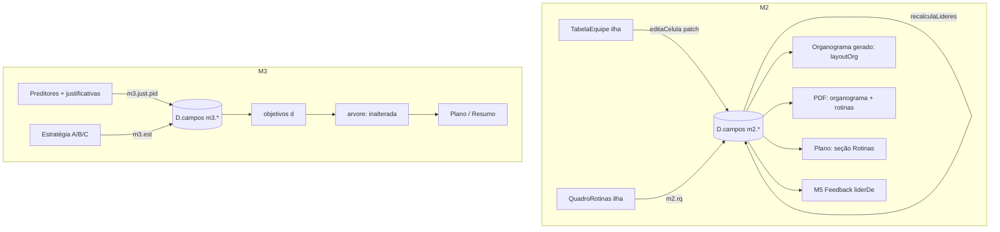

# Missões 2 e 3 · Reestruturação Design

**Spec**: `.specs/features/missao2-3-reestruturacao/spec.md`
**Status**: Draft (aguarda "PODE EXECUTAR")

Conforma AD-003 (ganchos só em `m2.js`/`m3.js`/`m5.js`, nunca em `conteudo.js`/`guia.js`/`resumo.js`/`novos.js`), AD-004 (regra em `lib/` como função pura, testes `node --test`), AD-005 (planos arquivados em `D.planos`, o ativo nos campos de hoje). Nenhuma decisão ativa é superada. Caminhos relativos a `plataforma/`.

---

## Architecture Overview

Ideia-chave: **reaproveitar o modelo de dados das cadeiras** (`m2.on`, `m2.f{n}`, `m2.p{n}.*`). A nova tabela da M2 é só uma **nova tela** sobre as mesmas chaves, e uma função pura recalcula a liderança (`m2.p{n}.lider`) a partir de categoria + área. Assim `liderDe`, `layoutOrg`, Missão 5 (Feedback) e o Resumo continuam funcionando sem mudança, e mandatos antigos migram por leitura, sem reescrever dado.

Na M3, a estratégia A/B/C **só decide o texto** que `objetivos()` devolve para cada preditor. A árvore (`arvore()`), as metas e o atingimento não são tocados.



---

## Code Reuse Analysis

### Existing Components to Leverage

| Component | Location | How to Use |
| --------- | -------- | ---------- |
| Cadeiras (`ativas`, `coordDe`, `liderDe`, `nomeDe`, `aplica`, `acrescenta`) | `lib/cadeiras.ts` | Base da tabela: linha = cadeira ativa; novas linhas usam índices 20+ (como `acrescenta`) |
| `layoutOrg` + `organogramaSvg` | `lib/layoutOrg.ts`, `lib/exporta.ts` | Organograma gerado e PDF: mesmo desenho; só some a aresta "entre áreas" |
| `Organograma.tsx` (React Flow) | `ilhas/equipe/Organograma.tsx` | Mantém o canvas; remove painel, anel de preenchimento, "Acrescentar cadeira" e destaque de rotina |
| `useEquipe`, `Chips`, `equipe.css` | `ilhas/equipe/` | Hook de gravação e estilos |
| `objetivos()`, `arvore()`, `alternaPreditor`, `desmarcaPreditor` | `lib/plano.ts` | `objetivos()` passa a ler a estratégia; resto intacto |
| `Preditores.tsx`, `useRumo` | `ilhas/rumo/` | Cartões clicáveis já existem; ganham a caixa de justificativa |
| `Plano.tsx`, `PlanoResumo.tsx` | `ilhas/rumo/` | Recebem seção de rotinas e nota de estratégia |
| `ponte.tsx` (`ILHAS`) | `ilhas/ponte.tsx` | Registro das ilhas novas |
| Padrão de override do legado | `public/legacy/m2.js`, `m3.js`, `m5.js` | Trocar `Comp.funcoes`, textos de `MISSOES`, `temConteudo` |
| Impressão do produto | `Entrega.tsx` (`window.print`), `equipe.css` (`es-nao-imprime`) | Base do PDF por impressão do navegador |

### Integration Points

| System | Integration Method |
| ------ | ------------------ |
| Missão 5 Feedback (`lib/feedback.ts`) | Lê `liderDe`; a tabela grava `lider` pela regra D8, então não muda |
| Resumo (`public/legacy/m2.js` `situacao()`) | Contadores passam a contar linhas da tabela (cadeiras ativas com nome) |
| Nuvem/`Store` | Tudo continua em `D.campos` (string → string), já sincronizado; **nenhuma chave nova de topo em `D`** |
| `D.planos` (M5) | Plano arquivado guarda só o que já guarda; a estratégia fica em `D.campos`, válida para o plano vigente |

---

## Components

### `lib/tabelaEquipe.ts` (novo, puro)

- **Purpose**: regra da tabela em ordem: colunas, travamento, linhas, quantidade, edição e liderança derivada.
- **Interfaces**:
  - `COLUNAS`: `['esc','comp','cargo','pessoa','cat','area']` com rótulos e dica
  - `CATEGORIAS = ['Chefia','Coordenação','Especialista','Executora']`
  - `linhas(c): Linha[]` – uma por cadeira ativa, com os 6 valores e `completa`
  - `colunaLiberada(linha, col): { ok: boolean; falta?: string }` – coluna N só com a N-1 preenchida (D3)
  - `defineN(c, n): { patch; remove?: number[]; confirma?: string[] }` – cresce com índices 20+; encolhe só linhas vazias, devolve `confirma` para preenchidas
  - `editaCelula(c, i, col, valor): Patch` – grava a célula e junta `recalculaLideres`
  - `recalculaLideres(c): Patch` – regra D8: Chefia → `-`; Coordenação → Chefia; Especialista/Executora → Coordenação da área, ou Chefia se não houver
  - `avisosOrg(c): string[]` – "Área sem coordenação", "Defina a chefia", "Mais de uma chefia"
  - `escopoTexto(c, i)`, `competenciasTexto(c, i)` – valor novo, ou derivado do formato antigo (chips de `escopo` + `espec`)
  - `categoriaPadrao(c, i)` – migração: cadeira 0 = Chefia; quem lidera alguém = Coordenação; resto = Executora
  - `migrada(c): boolean` – `m2.n` ausente com dados antigos
- **Dependencies**: `cadeiras.ts`, `equipe.ts`
- **Reuses**: `ativas`, `coordDe`, `aplica`, `AREAS`, `SEM_AREA`

### `ilhas/equipe/TabelaEquipe.tsx` (novo)

- **Purpose**: pergunta N, mostra as linhas, trava colunas, aviso de processo seletivo (`*`), "X de N linhas completas", celular em cartões.
- **Interfaces**: ilha `equipe-tabela`; grava via `useEquipe().agir`.
- **Reuses**: `useEquipe`, `equipe.css`.
- **Notas**: colunas bloqueadas usam `disabled` + legenda "Preencha antes: …" (`aria-describedby`). Área: `AREAS` + "Outra área" (`SEM_AREA`); para categoria Chefia aparece também "Chefia de gabinete" (valor `Chefia de área`, o padrão da cadeira 0).

### `ilhas/equipe/Organograma.tsx` (reduzido)

- **Purpose**: canvas gerado + avisos de `avisosOrg`; clicar na caixa leva à linha da tabela (`scrollIntoView` + foco na primeira célula editável).
- **Remove**: `PainelCadeira`, `Anel`, "Acrescentar cadeira", "Ajustar layout" manual não é necessário (o layout é automático); filtro por área e "só com nome" ficam.
- **Reuses**: `layoutOrg`, estilos `es-no`.

### `lib/quadroRotinas.ts` (novo, puro)

- **Purpose**: quadro-modelo de 5 rotinas e as preferências do mandato.
- **Interfaces**:
  - `MODELO: RotinaQ[]` (id `plan|mensal|semanal|area|feedback`, título, freq, quem, duração)
  - `lerQuadro(c): RotinaQ[]` – modelo + edições (`m2.rq` JSON `{ [id]: { freq?, quem?, dur?, on?, data?, hora? } }`)
  - `editaRotina(c, id, parcial): Patch`
  - `agendadas(c): { n, total }`
  - `concluida(c): boolean` – todas as ligadas com data e hora
  - `dataPassada(data): boolean` – só aviso
  - `areasDoMandato(c): string[]` – texto da linha "distribuição de trabalho"
- **Dependencies**: `cadeiras.ts`

### `ilhas/equipe/QuadroRotinas.tsx` (novo)

- **Purpose**: tabela das 5 rotinas, edição, liga/desliga, data e hora, botão do PDF.
- **Reuses**: `useEquipe`.

### `lib/exporta.ts` + `ilhas/equipe/PdfOrgRotinas.tsx` (novo)

- **Purpose**: botão "Gerar PDF do organograma e rotinas": monta um bloco `.pdf-org` oculto na tela (SVG do organograma + tabela das rotinas) e chama `window.print()` com `body.imprimindo-org`, CSS `@media print` mostra só esse bloco.
- **Interfaces**: `quadroRotinasHtml(rotinas): string` (puro, escapado) em `lib/exporta.ts`.
- **Notas**: sem organograma, imprime só as rotinas e avisa (AC 3). Usado na M2 (abaixo do quadro) e no Planejamento.

### `lib/estrategia.ts` (novo, puro)

- **Purpose**: estratégia A/B/C e justificativas dos preditores.
- **Interfaces**:
  - `lerEstrategia(c): 'a'|'b'|'c'|null` – `m3.est`; sem ela e com `m3.obj.*` preenchido → `'b'`; com preditores e nenhum texto → `'a'`; sem preditores → `null`
  - `defineEstrategia(c, e): Patch` – grava `m3.est`; nunca apaga `m3.obj.*`
  - `textoObjetivo(c, pid, e): string` – A: nome do preditor; B: `m3.obj.{pid}` ou nome; C: nome
  - `OBJETIVOS_LEGISLA` – as 3 frases da opção C
  - `lerJustificativa(c, pid)`, `defineJustificativa(c, pid, v): Patch` – `m3.just.{pid}`
  - `faltamJustificativas(c, escolhidos): number`
  - `passoPreditoresConcluido(c, escolhidos): boolean` – 3 escolhidos + estratégia + (B: 3 frases) + 5 justificativas (D12; só indicador, não bloqueia)
- **Dependencies**: `plano.ts` (`PREDITORES`)

### `lib/plano.ts` (alterado)

- `objetivos(d)` chama `textoObjetivo` da estratégia vigente; **assinatura e demais exports não mudam**. `arvore`, `podeAcrescentarMeta`, `contagemMetas`, `alternaPreditor`, `desmarcaPreditor` intactos (metas ficam como estão).
- Mensagens com "objetivo específico" → "objetivo estratégico".

### `ilhas/rumo/Preditores.tsx` (alterado) e `ilhas/rumo/Estrategia.tsx` (novo)

- **Preditores**: caixa "Este preditor foi escolhido pois…" no cartão marcado; "não foi escolhido pois…" nos 2 restantes quando há 3; contador "faltam N justificativas"; o campo de frase por preditor sai daqui.
- **Estratégia**: explicação de Objetivo Estratégico, 5 exemplos, 3 opções (radio), campo de frase por preditor só na B, nota de referência na C, confirmação ao trocar (guarda o texto anterior).
- **Reuses**: `useRumo`, `ArvorePlano` (prévia ao lado).

### `public/legacy/m3.js` (alterado) e `m2.js` (alterado)

- `m3.js`: `Comp.preditores` devolve as duas ilhas (`rumo-preditores`, `rumo-estrategia`); `temConteudo` do `m3.preditores` usa `passoPreditoresConcluido`; **passada de nomenclatura** sobre `MISSOES` (substitui "objetivo(s) específico(s)" → "objetivo(s) estratégico(s)", preservando maiúsculas e plural); `Telas.plano` com a frase nova.
- `m2.js`: `Comp.funcoes` devolve `equipe-tabela` + `organograma`; `Comp.gestao`/intro de `m2.gestao` troca `rotinas`/`entrega` por `quadro-rotinas`; textos novos da Mão na massa 1 e 2 conforme o documento; contadores `situacao()` contam linhas.

---

## Data Models

Tudo em `D.campos` (strings), sem tabela nova.

```typescript
// M2 · aditivo ao que existe (m2.on, m2.f{n}, m2.p{n}.nome_cargo/coord/lider)
'm2.n'        // quantidade de pessoas informada ("4"); ausente = tabela ainda não usada
'm2.p{n}.esc'   // escopo em texto livre (novo)
'm2.p{n}.comp'  // competências comportamentais, texto (novo)
'm2.p{n}.cat'   // 'Chefia' | 'Coordenação' | 'Especialista' | 'Executora'
'm2.rq'         // JSON: { [rotinaId]: { freq?, quem?, dur?, on?: boolean, data?: 'AAAA-MM-DD', hora?: 'HH:MM' } }

// M3 · aditivo
'm3.est'        // 'a' | 'b' | 'c'
'm3.just.{pid}' // justificativa de cada um dos 5 preditores (escolhido ou não)
// 'm3.obj.{pid}' continua guardando a frase da opção B (não é apagado ao trocar)
```

**Relacionamentos**: linha da tabela = cadeira ativa de `m2.on`. `m2.p{n}.escopo` (chips) e `espec` antigos permanecem e alimentam `escopoTexto()` quando `esc` está vazio. Dados sem tela (`hab_*`, `rep_*`, `ritmo`, `rel`, `entrega`, `fb_*`, `m2.x`, `m2.rotoff`) continuam gravados.

---

## Error Handling Strategy

| Error Scenario | Handling | User Impact |
| -------------- | -------- | ----------- |
| `N` fora de 1 a 40 ou não inteiro | `defineN` devolve `erro`; nada grava | Aviso "Informe de 1 a 40 pessoas" |
| Diminuir N com linhas preenchidas | `confirma` com nomes; só vazias saem sem perguntar | `window.confirm` antes de remover |
| Editar coluna anterior para vazio | Colunas seguintes travam, valores ficam | Legenda "Preencha antes: …" |
| Ciclo de liderança | Impossível: a regra D8 só aponta para Chefia/Coordenação de categoria superior | Sem tela de erro |
| `m2.rq` com JSON inválido | `lerQuadro` ignora e usa o modelo | Quadro padrão, sem erro |
| `m3.est` inválido | `lerEstrategia` trata como `null` e aplica a regra de migração | Passo aparece "sem estratégia" |
| Trocar estratégia com metas | A árvore não muda; só pede confirmação por segurança | Texto de cada nó muda; metas ficam onde estão |
| Impressão bloqueada pelo navegador | `window.print()` não lança; o botão não muda estado | Nada a tratar |

---

## Risks & Concerns

| Concern | Location | Impact | Mitigation |
| ------- | -------- | ------ | ---------- |
| `PADRAO` dá coord/lider padrão para índices 0-19 | `lib/equipe.ts:45`, `lib/cadeiras.ts:`coordDe`/`liderDe` | Linha nova nos índices 1-19 nasceria com área e liderança "preenchidas" sem o usuário escolher | Linhas novas usam só índices 20+; `defineN` nunca reativa os do modelo; linhas migradas gravam `coord`/`lider` explícitos |
| `ativas()` sempre inclui a cadeira 0 | `lib/cadeiras.ts:ativas` | N conta a Chefia e a linha 1 sempre existe | Documentado: N inclui a Chefia; `defineN` mínimo 1 |
| `conteudo.js` tem textos "objetivo específico" e `tests/legado-m3.test.ts` confere hash dos textos | `public/legacy/conteudo.js:304-422`, `tests/legado-m3.test.ts` | O teste de hash quebra por mudança intencional | T2 troca o teste para comparar contra o texto esperado pós-troca e confere que o resto não mudou |
| `Entrega.tsx`/`Rotinas.tsx`/`PainelCadeira.tsx` têm e2e próprios | `e2e/*equipe*.spec.ts` | Remoção quebra testes | T22 remove os testes junto com os componentes, listando cada um no commit |
| `Organograma.tsx` e `m2.js` têm mudanças do usuário não commitadas | `ilhas/equipe/Organograma.tsx`, `public/legacy/novos.js` | Commit pode sobrescrever trabalho | `git diff` antes de editar; `git add` só dos arquivos da tarefa (regra do M5) |
| React Flow em e2e depende de layout | `e2e/` do organograma | Teste frágil | Asserções por `data-cadeira`, não por posição |
| Impressão só testável por `emulateMedia` | `ilhas/equipe/PdfOrgRotinas.tsx` | Sem prova do PDF real | e2e com `emulateMedia({ media: 'print' })` confere o que fica visível; PDF final é conferido à mão |
| `npm run build` oscila com `SecurityFatalError` do Next 16.4 | build | Gate Build falha por motivo alheio | Mesma regra do M5: valer `tsc + test + e2e` e registrar a falha |

---

## Tech Decisions (só as não óbvias)

| Decision | Choice | Rationale |
| -------- | ------ | --------- |
| Onde guardar dados novos | `D.campos` (chaves `m2.*`, `m3.*`), não chaves novas de topo em `D` | `D.campos` já sincroniza com a nuvem e o Resumo; a spec dizia `D.estrategia` etc. e fica ajustada aqui |
| Liderança | Derivada e **gravada** em `m2.p{n}.lider` | Mantém `liderDe`, layout e Feedback sem mudança (AD-004) |
| Linhas novas | Índices 20+ | Evita os padrões de `PADRAO` (ver Risks) |
| Estratégia e árvore | Estratégia só troca o texto em `objetivos()` | Exigência do usuário: hierarquia e metas não mudam |
| Nomenclatura | Passada sobre `MISSOES` em `m3.js`, mais troca direta nos arquivos escritos à mão | `conteudo.js` é extraído e não pode ser editado (AD-003) |
| PDF | Impressão do navegador com bloco `@media print` | Sem dependência nova; padrão já usado em `Entrega.tsx` |
| Quadro de rotinas | Modelo fixo em código + edições em `m2.rq` | Texto vem da Legisla; edição por mandato |

> **Decisão de projeto** (vai para `.specs/STATE.md` como AD-006 na tarefa final): "Estrutura nova de tela sobre o modelo de cadeiras: `m2.*` continua a única fonte; telas novas escrevem as mesmas chaves e derivam liderança por função pura."
