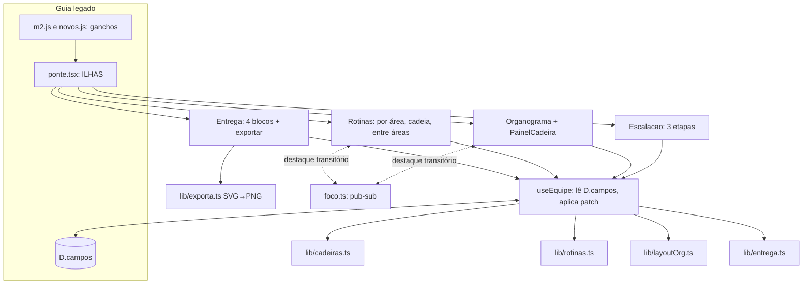

# Missão 2 · Equipe, Organograma e Rotinas Design

**Spec**: `.specs/features/missao2-equipe/spec.md`
**Status**: Draft

---

## Architecture Overview

Toda regra de negócio vira função pura em `plataforma/lib/` (testável com `node --test`, sem navegador). As telas são ilhas React que só leem o estado do Guia (`D.campos`), chamam essas funções e gravam o resultado pela ponte (`useLegado().bump()`). O legado não é editado: os ganchos entram em arquivos escritos à mão que a extração não sobrescreve: `public/legacy/m2.js` (novo, carregado depois de `novos.js`) e, para remover o gancho antigo, `novos.js`.



### Abordagens avaliadas (recomendação primeiro)

| Abordagem | Como | Prós | Contras |
| --------- | ---- | ---- | ------- |
| **A. React Flow + dagre + painel lateral (recomendada)** | Mantém a base atual (`@xyflow/react`, `@dagrejs/dagre`); caixas customizadas; painel ao lado | Zoom, foco por teclado e arestas pontilhadas prontos; reaproveita 80 linhas do organograma atual | Peso do React Flow no bundle da ilha (já pago hoje) |
| B. SVG feito à mão | Árvore desenhada e navegada por código próprio | Controle total, exporta fácil | Reimplementa zoom, pan e foco; mais código para testar |
| C. Árvore HTML aninhada | `<ul>` recursivo com CSS | Acessível por padrão | Não desenha linhas pontilhadas entre áreas nem faz zoom |

Escolha: A. A exportação PNG usa o mesmo layout em SVG próprio (`lib/exporta.ts`), sem depender do DOM do React Flow.

---

## Code Reuse Analysis

### Existing Components to Leverage

| Component | Location | How to Use |
| --------- | -------- | ---------- |
| `COORDENACOES`, `COR_COORD`, `PADRAO`, `ESCOPOS`, `HABILIDADES`, `chaveNome`, `chaveFicha`, `lista`, `SEP` | `plataforma/lib/equipe.ts` | Importar; sem alterar |
| Cálculo de árvore com dagre e "sobe até o líder visível" | `plataforma/ilhas/Equipe.tsx:142-172` | Extrair para `lib/layoutOrg.ts` (puro) e reutilizar em mini-organograma, canvas e exportação |
| `NoCargo` (caixa) e estilos `eq-*` | `plataforma/ilhas/Equipe.tsx:120-133`, `public/legacy/ilhas.css` | Evoluir a caixa (anel, selo); reutilizar classes |
| `Chips` (seleção múltipla) | `plataforma/ilhas/Equipe.tsx:39-53` | Mover para o painel |
| `useLegado`, `aviso`, montagem `[data-ilha]` | `plataforma/ilhas/ponte.tsx:43-109` | Registrar as ilhas novas em `ILHAS` |
| Wrapper de `Comp.funcoes` | `plataforma/public/legacy/novos.js:387-391` | Remover o gancho do seletor de bandeiras; `m2.js` passa a substituir `Comp.funcoes` por inteiro |
| `node --test "tests/**/*.test.ts"` e `allowImportingTsExtensions` | `plataforma/package.json`, `tsconfig.json` | Runner de testes unitários já existente |

### Integration Points

| System | Integration Method |
| ------ | ------------------ |
| Guia legado (`D.campos`, `Store.salvar`) | Só pelos helpers da ponte; chaves novas em `D.campos` (string) |
| Nuvem (Supabase `mandatos.dados` jsonb) | Nada novo: as chaves viajam dentro de `campos` |
| Contagens do legado (`nucleo.js:238`, `app.js:250`, `resumo.js:29`) | Substituídas em `m2.js` (override de `temConteudo`, `App.estadoTxt` e do bloco `funcoes` do Resumo) |
| Painel da Legisla | `public/painel.html:807-808, 1149` passam a contar cadeiras ativas |

---

## Components

### lib/cadeiras.ts (puro)

- **Purpose**: estado das cadeiras: quem está ativa, de que área, quem lidera quem; operações que devolvem um patch.
- **Location**: `plataforma/lib/cadeiras.ts`
- **Interfaces**:
  - `ativas(c): number[]` - cadeiras ativas; sem `m2.on`, deriva do formato antigo (MEQ-24)
  - `coordDe(c, i): string` / `liderDe(c, i): number | null` - valor gravado ou padrão
  - `alternaArea(c, coord, ligar): { patch; confirma?: string[] }` - MEQ-02, MEQ-04
  - `modeloCompleto(c): Patch` - MEQ-02
  - `acrescenta(c, opts): { patch; erro? }` / `remove(c, i): { patch; erro?; confirma?: string[] }` - MEQ-03, MEQ-08
  - `defineLider(c, i, novo): { patch?; ciclo?: number[] }` - MEQ-07
  - `aplica(c, patch)` - copia `Patch` (`Record<string,string>`; `''` apaga a chave) para `c`
- **Dependencies**: `lib/equipe.ts`
- **Reuses**: `PADRAO`, `COORDENACOES`, `chaveNome`, `chaveFicha`

### lib/rotinas.ts (puro)

- **Purpose**: gera as rotinas a partir das cadeiras e guarda as rotinas entre áreas.
- **Location**: `plataforma/lib/rotinas.ts`
- **Interfaces**:
  - `gerarRotinas(c): Rotina[]` - MEQ-17; determinística, ids estáveis (`plan`, `mensal`, `semanal`, `area:<coord>`, `fb:<líder>><liderado>`)
  - `cadeia(rotinas): Elo[]` - MEQ-18
  - `cadeirasDoElo(rotinas, id): number[]` e `rotinasDaCadeira(rotinas, i): Rotina[]` - MEQ-19
  - `sugestoesEntreAreas(c): Sugestao[]` / `criaEntreAreas(c, r): { patch; erro? }` - MEQ-20, MEQ-22
  - `desliga(c, id): Patch`
- **Dependencies**: `lib/cadeiras.ts`
- **Reuses**: o texto das 5 rotinas atuais (`ROTINAS` em `conteudo.js:43`)

### lib/layoutOrg.ts, lib/entrega.ts, lib/exporta.ts (puros)

- `layoutOrg(c, opts): { nos; arestas; areas }` - posições (dagre), arestas de hierarquia e arestas pontilhadas entre áreas.
- `sugestaoChecklist(c): { c1: boolean; c2: boolean; c3: boolean }` - MEQ-23.
- `organogramaSvg(c): string` - SVG do organograma completo com legenda; o navegador converte em PNG por `<canvas>`.

### ilhas/equipe/ (React)

| Arquivo | Função |
| ------- | ------ |
| `useEquipe.ts` | `useLegado` + `agir(resultado)`: aplica patch, mostra `aviso` em erro, chama `bump` |
| `Escalacao.tsx` | Ilha `equipe-escalacao`: stepper "Etapa X de 3", persiste `m2.etapa` |
| `EtapaAreas.tsx`, `EtapaCadeiras.tsx`, `EtapaNomes.tsx` | Uma etapa cada |
| `MiniOrg.tsx` | Prévia do organograma ao lado da etapa "Nomes" |
| `Organograma.tsx` | Ilha `organograma`: canvas, barra, filtros, teclado |
| `PainelCadeira.tsx` | Painel (desktop) ou gaveta (celular): escopo, perfil, repertório, rotinas da cadeira |
| `Rotinas.tsx` | Ilha `rotinas`: abas "Por área", "Cadeia", "Entre áreas" |
| `Entrega.tsx` | Ilha `entrega`: 4 blocos, sugestões do checklist, exportar PNG, imprimir |
| `foco.ts` | Pub-sub mínimo do destaque transitório (as ilhas são raízes React separadas) |

---

## Data Models

Tudo em `D.campos` (valores string). Chaves antigas continuam valendo.

| Chave | Conteúdo | Origem |
| ----- | -------- | ------ |
| `m2.f{n}` | nome da pessoa (`*` = processo seletivo) | existente |
| `m2.p{n}.*` | ficha: `nome_cargo`, `coord`, `lider`, `escopo`, `espec`, `hab_*`, `rep_*` | existente |
| `m2.coords` | áreas marcadas, separadas por `SEP` | novo |
| `m2.on` | índices das cadeiras ativas, separados por `SEP`; índices 20+ são cadeiras acrescentadas | novo |
| `m2.arq.{n}` | JSON `{nome, ficha}` de cadeira removida (base do "Desfazer") | novo |
| `m2.x` | JSON `[{id, de, para, finalidade, freq, canal}]` rotinas entre áreas | novo |
| `m2.rotoff` | ids de rotinas geradas desligadas | novo |
| `m2.etapa` | etapa atual da Tarefa 1 (1 a 3) | novo |
| `m2.c1..c3` | checklist | existente |
| `m2.areas`, `m2.areas_aplicadas` | bandeiras; preservadas, sem uso na Missão 2 | existente |

```typescript
type Patch = Record<string, string>;            // '' remove a chave
type Rotina = {
  id: string; tipo: 'plan' | 'mensal' | 'semanal' | 'area' | 'feedback' | 'entre';
  titulo: string; freq: 'Semanalmente' | 'Mensalmente' | 'Quadrimestralmente' | 'Semestralmente';
  duracao: string; convoca: number | null;
  participantes: number[];                       // todas as cadeiras envolvidas
  confirmados: number;                           // as que têm nome
  area?: string; grupo?: number;                 // área da reunião; líder do feedback
  de?: string; para?: string; finalidade?: string; canal?: string; // entre áreas
};
```

**Relationships**: a hierarquia sai de `liderDe`; a área de `coordDe`; as rotinas saem das duas; o organograma e a exportação leem o mesmo `layoutOrg`.

---

## Visual and Interaction Rules

- **Caixa**: pessoa (negrito), cargo, nome da área com a cor da área (barra superior), anel de progresso (campos do painel preenchidos de 6) e selo "escopo pendente". Vaga: borda tracejada, texto "Vaga em aberto" ou "Processo seletivo".
- **Cor nunca sozinha**: cada área também tem rótulo escrito; cada elo da cadeia tem número e ícone; a aresta entre áreas é pontilhada e rotulada.
- **Níveis**: mesma largura e forma para todas as caixas; hierarquia pela posição.
- **Painel**: abre à direita (≥ 900 px) ou como gaveta inferior (< 900 px); o foco vai ao primeiro campo; Esc fecha e devolve o foco à caixa.
- **Barra**: `Acrescentar cadeira`, `Ajustar layout`, `Exportar`, filtro por área, `Só preenchidas`, enquadrar (controles do React Flow). Ações de edição nunca ficam só em menu escondido.
- **Teclado**: caixas focáveis por Tab, `aria-label` "Pessoa, cargo, área, escopo pendente ou definido", Enter abre o painel; botão de recolher com `aria-expanded` e fora da ordem de Tab (P3).
- **Estados vazios**: "Marque ao menos uma área para liberar os nomes"; "Nenhuma rotina entre áreas ainda: aceite uma sugestão ou crie a sua".
- **Textos**: português do Brasil, verbos de ação nos botões, mensagens de erro dizem o que fazer.

---

## Error Handling Strategy

| Error Scenario | Handling | User Impact |
| -------------- | -------- | ----------- |
| Liderança cria ciclo | `defineLider` devolve a cadeia; ilha mostra "A → B → C voltaria para A" e mantém o valor anterior | Mensagem inline sob o campo |
| Passar de 40 cadeiras | `acrescenta` devolve `erro`; botão fica desabilitado no limite | Aviso com o limite |
| Remover Chefia de gabinete | `remove` devolve `erro` | Botão ausente na cadeira 0 e aviso se acionado por teclado |
| Desmarcar área com nomes | `alternaArea` devolve `confirma` com os nomes | Diálogo de confirmação; cadeiras vão para "Sem área" |
| Par de áreas igual | `criaEntreAreas` devolve `erro` | Campo de destino recusa a mesma área |
| Falha ao salvar na nuvem | `Store.salvar` já cai no local | Sem mudança; igual ao resto do Guia |
| JSON inválido em `m2.x` ou `m2.arq.*` | Leitura com `try/catch`, lista vazia | Rotinas entre áreas começam vazias; nada quebra |
| Mandato antigo sem `m2.on` | `ativas` deriva do formato antigo | Nada some (MEQ-24) |

---

## Risks & Concerns

| Concern | Location (file:line) | Impact | Mitigation |
| ------- | -------------------- | ------ | ---------- |
| Arquivos extraídos do HTML original recebem edição direta e são sobrescritos por `extrair_legado.py` | `plataforma/scripts/extrair_legado.py:58-100`; `guia.js` já tem edições diretas não commitadas | Mudança some na próxima extração | Nenhuma edição em `conteudo.js`, `guia.js`, `nucleo.js`, `app.js`, `resumo.js`: tudo em `m2.js` e `novos.js` (AD-003) |
| Árvore de trabalho tem mudanças não commitadas do usuário nos mesmos arquivos (`Equipe.tsx`, `ponte.tsx`, `novos.js`, `Recomenda.tsx`, `recomenda.ts`, `bandeiras.ts`) | `git status` | Commit pode levar trabalho alheio; remover `Recomenda.tsx` apagaria arquivo sem histórico | Cada commit usa `git add` de arquivos nomeados; `Recomenda.tsx`, `recomenda.ts` e `bandeiras.ts` ficam no disco, só desligados da Missão 2; decisão de apagar é do usuário |
| Contadores "de 20 cargos" no legado e no painel | `nucleo.js:238`, `app.js:250`, `resumo.js:29`, `painel.html:807-808,1149` | Mostram total errado com cadeiras ativas ≠ 20 | Override em `m2.js` e ajuste em `painel.html` (tarefas dedicadas) |
| `Ilhas.ligar` desmonta todas as raízes a cada troca de tela | `ilhas/ponte.tsx:96-98` | Estado só de componente se perde | Persistente em `D.campos` (etapa, áreas, cadeiras); destaque é transitório e pode se perder |
| O corpo da Missão 2 hoje espalha 20 `<input data-k="m2.f{n}">` renderizados pelo legado | `guia.js:290-307` | Duas fontes de edição do mesmo nome | `Comp.funcoes` é substituído por completo em `m2.js`; nome só é editado na ilha |
| Next 16 tem mudanças de convenção | `plataforma/AGENTS.md` | Rota de teste errada | A tarefa da rota de teste lê `node_modules/next/dist/docs/` antes de escrever |
| O Guia exige login para chegar às telas | `public/legacy/nucleo.js` (Supabase) | Playwright não chega à Missão 2 | Rota de teste `app/teste-equipe` monta as ilhas com `D`/`Store` simulados; só existe fora de produção |
| `@dagrejs/dagre` em Node puro (testes) não foi verificado | `package.json` | Teste de `layoutOrg` pode não rodar | Primeira tarefa do layout roda o import em `node --test`; se falhar, fica como "não sei" e a tarefa ajusta |
| Playwright baixa navegador (~150 MB) | `package.json` | Instalação lenta ou bloqueada | Navegador só Chromium; passo registrado na tarefa de instalação |

---

## Tech Decisions

| Decision | Choice | Rationale |
| -------- | ------ | --------- |
| Testes de lógica | `node --test` (já no repo), não Vitest | Zero dependência nova; Node 25 roda `.ts`; revisa o que a spec dizia |
| Testes de tela | Playwright, Chromium | Não há runner de componente no repo; a spec exige jornada |
| Onde entram os ganchos do legado | `m2.js` (novo) + remoção em `novos.js` | Arquivos escritos à mão, não sobrescritos pela extração; `m2.js` isola a Missão 2 e é testável com `node:vm` |
| Cadeiras acrescentadas | Índice 20+ em `m2.on`; remoção guarda cópia em `m2.arq.{n}` | Não renumera `m2.f{n}`; permite desfazer |
| Exportar PNG | SVG próprio → `<canvas>` | Sem dependência; testável como texto; independe do DOM do React Flow |
| PDF | `window.print()` com CSS de impressão | Sem dependência |
| Compartilhar destaque entre ilhas | `foco.ts` pub-sub, transitório | Ilhas são raízes React separadas; estado persistente fica em `D.campos` |
| Escopo e perfil | Só no painel do organograma | Pedido do usuário |
| Regra de rotinas | Funções puras sobre `D.campos`, sem guardar o resultado | Nunca desatualiza; só preferências (`m2.rotoff`, `m2.x`) são gravadas |

> **Project-level decisions** gravadas em `.specs/STATE.md`: AD-003 (ganchos do legado só em arquivos escritos à mão: `novos.js` e `m2.js`) e AD-004 (lógica de negócio em `lib/` pura, testada com `node --test`).
