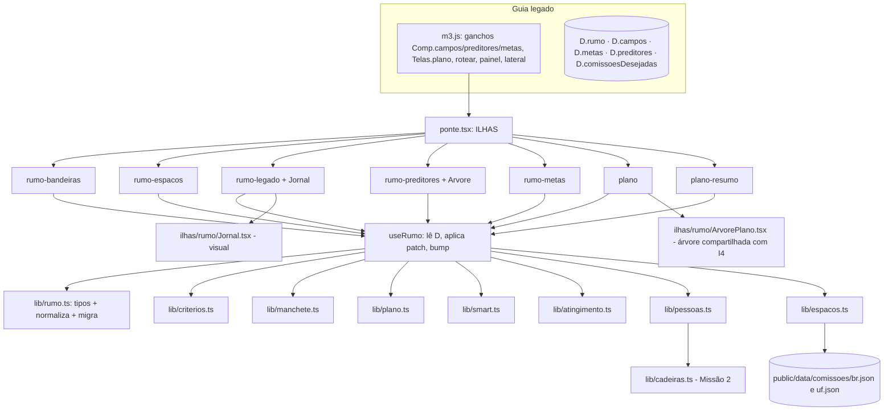

# Missão 3 · Defina o Rumo (Planejamento Estratégico) Design

**Spec**: `.specs/features/missao3-rumo/spec.md`
**Status**: Draft

Decisões ativas de `STATE.md` seguidas: AD-003 (ganchos só em arquivos escritos à mão: `m3.js` novo, carregado depois de `m2.js`) e AD-004 (regra em `lib/` como função pura sobre `D.campos`/`D`; testes `node --test`; imports relativos terminando em `.ts`). Nenhuma é substituída.

---

## Architecture Overview

Uma única fonte de verdade por dado, a mesma que o Guia, o Resumo, a nuvem e a Missão 5 já leem. O exercício e a aba Planejamento são duas telas sobre os mesmos dados: editar numa reflete na outra.

| Dado | Onde vive | Quem escreve |
| ---- | --------- | ------------ |
| Bandeiras levantadas, argumentos, critérios, notas, prioritárias | `D.rumo.bandeiras`, `D.rumo.criterios` (novo) + espelho em `D.campos` `m3.mural`, `m3.argumentos`, `m3.criterios`, `m3.b1..b3` | ilha `rumo-bandeiras` |
| Espaços pretendidos | `D.comissoesDesejadas` (existente; campos `comissao`, `cargo`, `bandeira` mantidos; acrescenta `papel` opcional) | ilha `rumo-espacos` |
| Legado | `D.rumo.legado` (elementos, modelo, rascunhos, jornal) + espelho `m3.legado`, `m3.cargo` | ilha `rumo-legado` |
| Preditores e objetivos | `D.preditores` + `D.campos['m3.obj.{pid}']` (existentes) | ilha `rumo-preditores` |
| Metas | `D.metas[]` (existente; acrescenta `status`, `respCad`, `apoioCad`, `alcancavel`) | ilhas `rumo-metas` e `plano` |
| Pessoas | cadeiras ativas da Missão 2 via `lib/cadeiras.ts` (leitura) | só leitura |



### Abordagens avaliadas (recomendação primeiro)

| Abordagem | Como | Prós | Contras |
| --------- | ---- | ---- | ------- |
| **A. Ilhas React + `D.rumo` + espelho `m3.*` (recomendada)** | Mesmo padrão da Missão 2: `lib/` puro, ilhas, ganchos em `m3.js` | Reaproveita ponte, `useLegado`, testes e2e; Resumo, painel e nuvem seguem funcionando pelo espelho | Duas representações (estruturada + texto) a manter sincronizadas; coberto por teste |
| B. Reescrever só em JS legado | Mais DOM manual em `novos.js` | Sem React | Árvore, jornal e edição inline ficariam frágeis; sem teste de tela |
| C. Trocar o estado por um store React novo | Estado fora de `D` | Modelo limpo | Quebra a regra da casa ("não crie estado global paralelo"), nuvem e Resumo |

### Preservação dos textos (regra do usuário)

Os ganchos só trocam o **corpo interativo** (`itens` dos exercícios `campos`; `Comp.preditores`; `Comp.metas`). `intro`, `passos`, `fim`, `d`, `t`, os exemplos e o `#blocoMetasRef` não são tocados. Um teste de regressão (`tests/legado-m3.test.ts`) carrega `conteudo.js` em `node:vm`, faz o hash desses campos para os 4 exercícios da Missão 3 e compara com o hash gravado antes da mudança; qualquer alteração falha o gate. Textos novos da interface ficam nas ilhas, nunca em `conteudo.js`.

---

## Code Reuse Analysis

### Existing Components to Leverage

| Component | Location | How to Use |
| --------- | -------- | ---------- |
| `BANDEIRAS`, `bandeiraDoRotulo`, `MAX_BANDEIRAS` | `lib/bandeiras.ts` | Taxonomia das bandeiras (mesmos rótulos da Missão 2); não editar |
| `PREDITORES`, `OBJ_ESPECIFICOS`, `FORMULA_META` | `public/legacy/conteudo.js` | Lidos em runtime por `window`; copiados como constantes tipadas em `lib/plano.ts`/`lib/smart.ts` com teste de paridade |
| `ativas`, `nomeDe`, `nomeLimpo`, `chaveFicha` | `lib/cadeiras.ts`, `lib/equipe.ts` | Lista de pessoas para responsável e apoio |
| `useLegado`, `dadosGuia`, `mandato`, `aviso` | `ilhas/ponte.tsx` | Estado, bump, avisos |
| Padrão `Comp.campos` + regex de troca (`CX`) | `public/legacy/novos.js:383` | Trocar o corpo dos exercícios por `<div class="ilha" data-ilha>` |
| `App.lateral` override | `public/legacy/novos.js` (bloco "menu lateral") | Inserir o item "Planejamento Estratégico" |
| `Recomenda.tsx`, `recomenda.ts` | `ilhas/`, `lib/` | Referência de estilo; `m3.b1..b3` já são lidos ali |
| Rota de teste e harness | `app/teste-equipe/page.tsx`, `e2e/harness.spec.ts`, `e2e/semente.ts` | Mesmo padrão para `app/teste-rumo/` |
| `ilhas.css`, `equipe.css` | `public/legacy/ilhas.css`, `ilhas/equipe/equipe.css` | Tokens de cor e padrões de card; CSS novo em `ilhas/rumo/rumo.css` |

### Integration Points

| System | Integration Method |
| ------ | ------------------ |
| Resumo (`resumo.js`) | Lê `m3.*`, `D.preditores`, `D.metas[].resp/texto`; o espelho mantém tudo legível. `resp` continua string |
| Missão 5 (`monit`, `mon.*`) | `Comp.monit` lê `D.metas[i].texto/resp/pred`; os campos são preservados |
| Nuvem (`Store.salvar`) | `D.rumo` entra no mesmo JSON `mandatos.dados`; sem migration de schema |
| Painel Legisla (`painel.html`) | Só conta preenchimento; `m3.*` espelhados mantêm a contagem |
| `Store.mandato.cargo`, `.casa`, `.uf`, `.data_posse`, `.nome_parlamentar` | Cargo atual, UF, data do jornal e nome |

---

## Components

### lib/rumo.ts

- **Purpose**: Tipos do estado novo, normalização e migração do formato antigo.
- **Interfaces**:
  - `lerRumo(d: DadosM3): Rumo` - devolve `D.rumo` normalizado (sem mutar); cria bandeiras do mural antigo.
  - `aplicaRumo(d, patch)` - grava e reespelha `m3.*`.
  - `espelho(rumo): Patch` - texto legível para `m3.mural`, `m3.argumentos`, `m3.criterios`, `m3.b1..b3`, `m3.legado`, `m3.cargo`.
- **Dependencies**: `lib/bandeiras.ts`.
- **Reuses**: `bandeiraDoRotulo`.

### lib/criterios.ts

- **Purpose**: Notas, ranking e prioritárias das bandeiras.
- **Interfaces**:
  - `CRITERIOS_GUIA: Criterio[]` - os 4 do Guia.
  - `total(b: BandeiraNota, criterios): number`
  - `ranking(bandeiras, criterios): {id; total; sugerida}[]` - ordena por total desc, empate pela ordem de entrada; `sugerida` nas 3 primeiras com nota.
  - `alternaPrioritaria(rumo, id): {rumo; erro?: string}` - recusa a 4ª.
  - `adicionaCriterio`, `removeCriterio` (máx. 8).

### lib/manchete.ts

- **Purpose**: Compor e conferir a manchete; modelos; cargos postuláveis.
- **Interfaces**:
  - `cargosPostulaveis(cargoAtual: string): string[]` - ver tabela abaixo.
  - `compoe(el: ElementosLegado, ctx: {nome; bandeiras}): string`
  - `MODELOS: Modelo[]` - 4 modelos com lacunas.
  - `aplicaModelo(modelo, ctx): ElementosLegado`
  - `mencionaCargo(texto, cargo): boolean` - normaliza acentos, gênero `(a)` e artigos.
  - `avisos(texto, cargo): string[]` - cargo ausente, > 280 caracteres.
  - `dataEdicao(dataPosse?: string): string` - "dezembro de {ano da posse + 3}" ou `"ao fim da legislatura"`.

Cargos por cargo atual (inferência nossa, ver spec):

| Cargo atual | Opções |
| ----------- | ------ |
| Deputado(a) Estadual | Reeleição a Deputado(a) Estadual · Deputado(a) Federal · Senador(a) · Vice-governador(a) · Governador(a) · Prefeito(a) · Outro |
| Deputado(a) Federal | Reeleição a Deputado(a) Federal · Senador(a) · Vice-governador(a) · Governador(a) · Prefeito(a) · Outro |
| Senador(a) | Reeleição ao Senado · Governador(a) · Vice-presidente · Presidente · Outro |
| Vereador(a) | Reeleição a Vereador(a) · Prefeito(a) · Vice-prefeito(a) · Deputado(a) Estadual · Deputado(a) Federal · Outro |
| outro/vazio | lista completa |

### lib/smart.ts

- **Purpose**: Retorno SMART determinístico para uma meta.
- **Interfaces**:
  - `avaliaMeta(m: {texto; pred?; alcancavel?}): Retorno` com `letras: Record<'S'|'M'|'A'|'R'|'T', {ok: boolean; dica: string}>`, `alertas: string[]`, `pontos: 0..5`.
- **Regras** (todas puras; texto normalizado sem acento e em minúsculas):
  - S: primeira palavra termina em `ar|er|ir|or` (infinitivo, com lista de exceções como "mar", "ver" tratadas por tamanho mínimo 4) **e** ao menos 6 palavras.
  - M: `\d`, `%`, ou palavra de quantidade (`um|uma|dois|duas|tres|quatro|cinco|seis|sete|oito|nove|dez|vinte|metade|todos|todas`).
  - T: mês, ano com 4 dígitos, `ate`, `dias|semanas|meses`, `mensal|semanal|quinzenal|trimestral|semestral|anual`, `por mes|por semana`.
  - R: `pred` definido. A: `alcancavel === true`.
  - Alerta de rotina: `/enviar e-?mails?|fazer reuni|responder|atender|postar|publicar diariamente|todo dia|diariamente/`.
- **Limite honesto**: é heurística, não entende sentido. A interface diz "retorno automático por regras; a decisão é da equipe" e nunca bloqueia a gravação.

### lib/plano.ts

- **Purpose**: Hierarquia do planejamento e regras de objetivos e metas.
- **Interfaces**:
  - `objetivos(d): Objetivo[]` - um por preditor em `D.preditores`, texto de `m3.obj.{pid}` ou nome do preditor.
  - `arvore(d): Arvore` - `{legado, bandeiras, objetivos: [{...obj, metas}], semObjetivo: Meta[]}`.
  - `podeAcrescentarMeta(d, pid): {ok; motivo?}` - exige preditor; máx. 4 por objetivo.
  - `contagemMetas(d): {n; faixa: 'abaixo'|'ok'|'acima'}` - 10 a 16.
  - `desmarcaPreditor(d, pid): {afetadas: number; patch}` - metas ficam com `pred` vazio.
  - `normalizaMeta(m): Meta` - status default `nao_concluida`.

### lib/atingimento.ts

- **Purpose**: Status e porcentagens.
- **Interfaces**:
  - `STATUS: {id: 'concluida'|'concluida70'|'nao_concluida'|'congelada'; rot: string; pct: number|null}[]`
  - `pctMeta(status): number | null` - `null` para congelada.
  - `pctObjetivo(metas): number | null` - média das não congeladas, `Math.round`; `null` sem metas ativas.
  - `pctTotal(objetivos): number | null` - média dos objetivos com pct não nulo.

### lib/pessoas.ts

- **Purpose**: Quem pode ser responsável ou apoio.
- **Interfaces**:
  - `pessoas(c: Campos): Pessoa[]` - `{cad: number; nome; cargo; area}` das `ativas` com nome (sem `*`).
  - `resolve(c, m: Meta): {resp: string; foraDaEquipe: boolean; apoios: string[]}` - nome atual pela cadeira; se a cadeira não existe mais, o nome gravado e `foraDaEquipe`.
  - `validaApoio(resp, apoios): string | null` - recusa igual ao responsável e mais de 3.

### lib/espacos.ts

- **Purpose**: Sugestões e alertas dos espaços.
- **Interfaces**:
  - `TIPOS_ESPACO` por Casa: titular/suplente de comissão, presidência, vice-presidência, relatoria, Mesa Diretora, liderança (partido, bloco, bancada), Frente Parlamentar, CPI/CPMI, conselho ou colegiado, outro.
  - `sugestoes({cargo, uf, bandeiras}, catalogo?): Sugestao[]`
  - `TEMAS_POR_BANDEIRA: Record<string, string[]>` - bandeira → nomes genéricos de comissão.
  - `alerta(espaco, prioritarias): string | null`
  - `faltaBandeira1(espacos, prioritarias): boolean` - mostra a dica do Guia.
- **Dependencies**: catálogo carregado por `fetch` na ilha (não na lib); a lib recebe o catálogo pronto.

### scripts/build_comissoes.py

- **Purpose**: Gera `public/data/comissoes/br.json` com as comissões permanentes da Câmara dos Deputados (nome, sigla, tema). Biblioteca padrão, como os outros `build_*.py`.
- **Cuidado**: a forma da API de dados abertos da Câmara **não foi verificada**; o primeiro passo da tarefa confere o endpoint e o formato antes de escrever o parser. Se a API não responder, o script falha com mensagem e não grava arquivo vazio.

### ilhas/rumo/useRumo.ts

- **Purpose**: Ligação entre `D` e as ilhas.
- **Interfaces**: `useRumo(): {d; rumo; metas; objetivos; pessoas; set(patchRumo); setMeta(id, patch); bump}`; toda escrita passa por `aplicaRumo`/`normalizaMeta` e termina em `bump()`.
- **Reuses**: `useLegado` de `ponte.tsx`.

### ilhas/rumo/Bandeiras.tsx (`rumo-bandeiras`)

- **Purpose**: Mural + card por bandeira (argumentos, notas por critério) + ranking com estrela de prioritária.
- **Layout**: coluna esquerda com chips das 19 agendas (selecionar abre o card), "Outra bandeira", resumo da Missão 1 (reaproveita o bloco `recap` de `novos.js` lendo os mesmos campos); direita com os cards e, no fim, o ranking.
- **Reuses**: `BANDEIRAS`, `ranking`.

### ilhas/rumo/Espacos.tsx (`rumo-espacos`)

- **Purpose**: Tipos de espaço por cargo/Casa, sugestões por bandeira, registro com papel e alerta.
- **Reuses**: `espacos.ts`; lê `comissoes/br.json` ou `comissoes/{uf}.json` (404 → sem catálogo, modo genérico).

### ilhas/rumo/Legado.tsx (`rumo-legado`) e Jornal.tsx

- **Purpose**: Condução em 4 passos e primeira página de jornal ao vivo.
- **Layout**: passo a passo à esquerda (marcador de edição: Protagonista · Entrega · Resultado · Cargo, cada um "acende" ao completar), jornal à direita; em celular o jornal vai abaixo e vira sticky resumido. Botão "Fechar a edição" só habilita com os 4 preenchidos.
- **Visual do jornal** (`Jornal.tsx`, SVG/HTML estático, sem imagem externa): faixa do título com nome editável em serif de alto contraste, filete duplo, data de edição, manchete em fonte display grande em até 4 linhas, linha-fina com as bandeiras e o cargo, duas colunas de texto cinza simulando matéria (decorativas, `aria-hidden`), selo "Edição fechada" em carimbo girado. A direção estética final (tipografia, paleta, textura de papel) é definida na tarefa com a skill `frontend-design`; o contrato é só o componente `Jornal({nome, manchete, linhaFina, dataEdicao, jornal, fechado})`.
- **Modelos**: carrossel de 4 cartões "sugestão da plataforma" acima dos passos; escolher preenche e continua editável.
- **Rascunhos de grupo**: gaveta "Manchetes dos grupos" (nome do grupo + manchete + cargo), botão "Usar como base".

### ilhas/rumo/Preditores.tsx (`rumo-preditores`) e ArvorePlano.tsx

- **Purpose**: Seleção dos 3 preditores com o objetivo específico no próprio cartão (campo abre ao selecionar, com o exemplo do Guia como sugestão) e a árvore crescendo ao lado.
- **ArvorePlano**: componente de árvore recolhível (HTML aninhado com `role="tree"`, setas/Enter/Espaço) usado nas duas telas; recebe `modo: 'previa' | 'plano'`. Em `previa` mostra Legado → objetivos; em `plano` acrescenta metas, status e barras.

### ilhas/rumo/Metas.tsx (`rumo-metas`) e CartaoMeta.tsx

- **Purpose**: Lista de metas agrupada por objetivo; cada `CartaoMeta` tem texto, retorno SMART ao vivo (5 letras como selos, dica da primeira que falta), confirmação de "alcançável", seletor de responsável e apoios (chips das pessoas da Missão 2 + texto livre) e, só na aba, seletor de status.
- **Reuso**: `CartaoMeta` é o mesmo componente no exercício e na aba (requisito RUM-40/08).

### ilhas/rumo/Plano.tsx (`plano`) e PlanoResumo.tsx (`plano-resumo`)

- **Purpose**: `Plano`: topo com anel de atingimento total e filtro por pessoa; árvore em modo `plano`; "Acrescentar meta" por objetivo; botão Imprimir; ordenar (P3). `PlanoResumo`: manchete resumida, anel total, barra por objetivo, botão "Abrir o planejamento" ou convite à Missão 3.

### public/legacy/m3.js (gancho, escrito à mão)

- **Purpose**: Overrides sobre o legado, carregado depois de `m2.js`.
- **Pontos**:
  - `Comp.campos` (substitui o corpo de `m3.bandeiras` e `m3.legado` por ilhas; o corpo de qualquer outro exercício passa direto), `Comp.preditores`, `Comp.metas`.
  - `Telas.plano = ...` (renderiza `<div class="ilha" data-ilha="plano">`).
  - `App.rotear` (envolve: se `#/plano`, chama `Telas.plano` e `marcar/lateral`; senão o original).
  - `App.lateral` (acrescenta o link "Planejamento Estratégico").
  - `Telas.painel` (chama o original e troca no DOM o bloco "Últimos registros" por `<div class="ilha" data-ilha="plano-resumo">`; sem eventos o bloco não existe e o resumo é inserido antes do botão "Ver tudo o que foi preenchido").
  - `Guia.mostrar`/`estadoEx`: conclusão dos exercícios da M3 considera o novo estado (bandeiras prioritárias, manchete fechada, preditores e metas já têm checagem em `nucleo.js:239`).
- **Registro**: `app/guia/page.tsx` carrega `m3.js` depois de `m2.js` e antes de `cadastro`; `ilhas/ponte.tsx` registra as 7 ilhas novas.

---

## Data Models

```typescript
type CriterioId = string;
interface Criterio { id: CriterioId; rot: string; guia: boolean }          // guia = um dos 4 do Guia
interface BandeiraRumo {
  id: string;                    // id da taxonomia ou "x-<uid>" para outra bandeira
  rot: string;
  argumentos: string;
  notas: Record<CriterioId, number>;   // inteiro 0..5
  prioridade: number | null;     // 1..3 na ordem de confirmação
}
interface ElementosLegado { protagonista: string; entrega: string; resultado: string; cargo: string; cargoOutro?: string }
interface RascunhoLegado { id: string; grupo: string; manchete: string; cargo: string }
interface LegadoRumo {
  modelo?: 'reeleicao' | 'outro-cargo' | 'camara-senado' | 'entrega';
  el: ElementosLegado;
  manchete: string;              // texto final; se 'manual', não é recomposto
  manual: boolean;
  jornal: string;                // "A Gazeta do Mandato"
  fechado: boolean;
  rascunhos: RascunhoLegado[];
}
interface Rumo { v: 1; criterios: Criterio[]; bandeiras: BandeiraRumo[]; legado: LegadoRumo; objetivoAno?: string }

type StatusMeta = 'concluida' | 'concluida70' | 'nao_concluida' | 'congelada';
interface Meta {                  // D.metas[i], campos antigos preservados
  id: string; pred?: string; texto?: string; resp?: string; apoio?: string;       // legado
  status?: StatusMeta;            // default nao_concluida
  respCad?: number | null; apoioCad?: number[]; alcancavel?: boolean;
}
```

**Relacionamentos**: `Meta.pred` já existe e é a chave do objetivo (1:1 com o preditor); o objetivo da meta é derivado de `pred`; não existe campo `obj` gravado. Prioridade da bandeira = `m3.b{prioridade}`. Pessoa = índice de cadeira da Missão 2; `resp`/`apoio` guardam o nome em texto para o legado e o Resumo.

**Migração** (`lerRumo`, sem mutar nem gravar até a primeira edição): sem `D.rumo`, `bandeiras` nasce de `m3.mural` e `m3.b1..b3` reconhecidos por `bandeiraDoRotulo`; rótulos não reconhecidos viram bandeiras "outras". `legado.manchete` e `el.cargo` nascem de `m3.legado` e `m3.cargo`, com `manual: true`. Metas sem `status` valem `nao_concluida`. Nada é apagado.

---

## Error Handling Strategy

| Error Scenario | Handling | User Impact |
| -------------- | -------- | ----------- |
| `D.rumo`/`D.metas` com formato inesperado | `lerRumo`/`normalizaMeta` descartam só o campo inválido e mantêm o texto | Nada some; a tela abre normal |
| `comissoes/{uf}.json` ausente (404) ou JSON inválido | Ilha cai para o modo genérico por bandeira | Vê nomes genéricos e campo livre; sem erro |
| Cadeira da Missão 2 removida ou renomeada | `resolve` mostra o nome atual ou o gravado com "fora da equipe" | A meta não perde o responsável |
| Falha de salvamento na nuvem | Mesmo caminho do Guia (`Store.salvar`, indicador "salvando") | Sem mudança de comportamento |
| Preditor desmarcado com metas | Confirmação com a contagem; metas ficam "sem objetivo" | Nada é apagado |
| Texto com HTML | Renderização por React (texto puro); espelho `m3.*` é texto, e o legado já escapa com `esc`/`rich` | Aparece como texto |
| Heurística SMART errada | Só orienta, nunca bloqueia; botão "Ignorar sugestão" no selo | Equipe decide |

---

## Risks & Concerns

| Concern | Location (file:line) | Impact | Mitigation |
| ------- | -------------------- | ------ | ---------- |
| Árvore de trabalho com mudanças não commitadas nos mesmos arquivos (`ponte.tsx`, `novos.js`, `guia.js`, `Equipe.tsx`, `lib/types.ts`) | `plataforma/ilhas/ponte.tsx`, `public/legacy/novos.js`, `public/legacy/guia.js` | Sobrescrever trabalho do usuário | `git diff` do arquivo antes de editar; `git add` só com arquivos nomeados; ganchos novos em `m3.js`, não em `guia.js` |
| `conteudo.js`, `guia.js`, `app.js` são regenerados pela extração | `scripts/extrair_legado.py` | Override perdido se vivesse neles | AD-003: tudo em `m3.js`; teste de regressão dos textos |
| Dupla representação (estruturada + espelho `m3.*`) | `lib/rumo.ts` | Divergência entre as duas | `aplicaRumo` é o único ponto de escrita e reespelha; teste de ida e volta |
| `Telas.painel` é reescrito por DOM após o original | `public/legacy/app.js:151-195` | Quebra se o HTML do painel mudar | Seletor por texto do `h2` "Últimos registros" com fallback de inserir antes do botão final; teste e2e |
| Passo 4 das metas lê `D.metas[i].pred` | `public/legacy/guia.js:437`, `Comp.monit` | Mudar a forma de `pred` quebra a Missão 5 | `pred` permanece o id do preditor; campos antigos intocados |
| `Comp.metas` e `Comp.preditores` são chamados em `Guia.render` a cada mudança | `public/legacy/guia.js:309-362` | Remontagem da ilha perde foco do campo | Ilhas guardam foco/rascunho em `D` ou ref e remontam só em troca de tela (padrão da Missão 2: `ponte.tsx`) |
| Catálogo de comissões envelhece a cada legislatura | `public/data/comissoes/br.json` | Sugestão desatualizada | Arquivo gerado por script com data de geração mostrada na tela; Assembleias começam genéricas |
| Heurística SMART usa regex sobre português | `lib/smart.ts` | Falsos positivos e negativos | Testes com exemplos do Guia (a meta de exemplo precisa dar 5/5); aviso de que é automático; nunca bloqueia |
| `npm run build` oscila com `SecurityFatalError` do Next 16.4 | `package.json` | Gate de build instável | Mesmo contorno da Missão 2 (gate sem build + `next dev` 200 em `/guia`) |
| Sem verificação em navegador real nas últimas features | memória do projeto | Defeito visual só aparece em uso | Testes e2e Playwright por ilha e verificação final com captura de tela |

---

## Tech Decisions

| Decision | Choice | Rationale |
| -------- | ------ | --------- |
| Estado novo vs. reuso | Reusar `D.metas`, `D.preditores`, `D.comissoesDesejadas`; só `D.rumo` é novo | Resumo, Missão 5 e nuvem continuam sem mudança |
| Objetivo específico | Chave `m3.obj.{pid}` existente | Já lido por Resumo e Missão 5 |
| Feedback SMART | Regras determinísticas | Testável, gratuito, privado |
| Média do atingimento | Simples, sem pesos | Explicável em uma frase; pesos ficam para a v2 |
| Árvore | HTML aninhado com `role="tree"` | Acessível por padrão; não precisa de zoom |
| Jornal | HTML/SVG sem imagens externas | Sem dependência e imprime bem |
| Imagem da primeira página (P3) | Decidida na tarefa: `html-to-image` se cumprir o gate, senão impressão | Não verificado nesta sessão |
