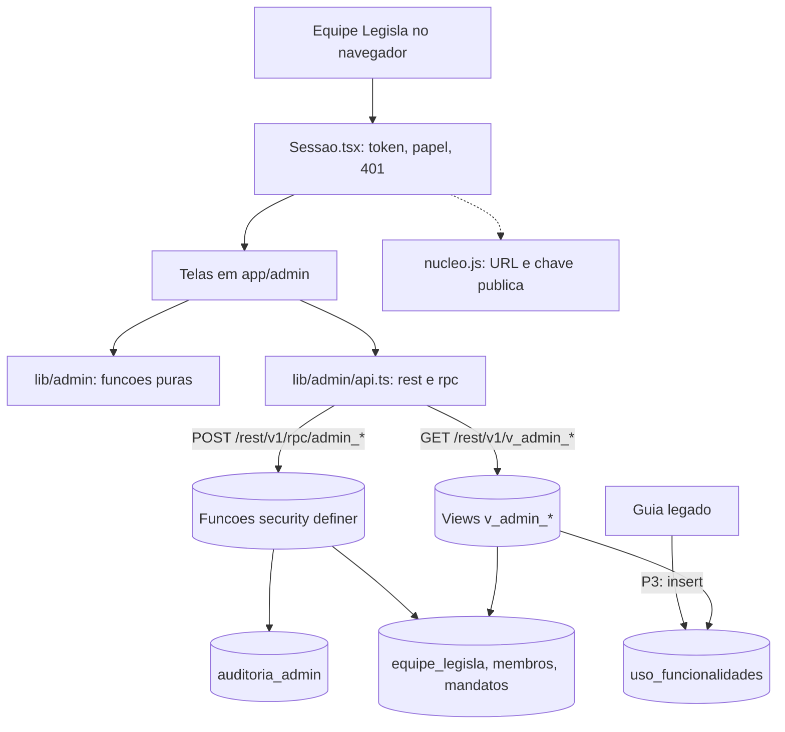

# Painel do Administrador Design

**Spec**: `.specs/features/painel-admin/spec.md`
**Status**: Draft

Caminhos abaixo relativos a `plataforma/`, salvo `.specs/` e `wireframes/`.

---

## Abordagens consideradas

| | Abordagem | Prós | Contras |
| - | --------- | ---- | ------- |
| **A (recomendada)** | Rotas Next.js em `/admin`, falando com o Supabase por `fetch` com a chave pública e a sessão do usuário. Leitura por views `v_admin_*`, escrita por funções SQL `security definer` com auditoria. Contas e agregados em TS puro, testado | Sem segredo novo, sem servidor próprio; mesma sessão do `/painel`; a regra de segurança fica no banco; lógica testável com `node --test` | Exige 4 migrations e teste de SQL (PGlite) |
| B | Rotas de servidor do Next com `service_role` | Poderia convidar quem não tem conta e ler logs da Vercel | Guarda a chave mais poderosa no ambiente; contraria o `CLAUDE.md`; cada rota vira superfície de ataque. Os dois ganhos são exatamente o que a spec deixou fora |
| C | Estender `public/painel.html` | Nenhum app novo | 1.238 linhas de HTML à mão; sem testes; hoje já baixa `mandatos.*` inteiro para o navegador (risco 1) |

**Escolha: A.** A tabela não pede confirmação extra se você não objetar; as consequências estão em Tech Decisions.

---

## Architecture Overview

O navegador autentica com o token de `legisla.tok`, lê só views com colunas sem texto e altera dados só por funções que checam o papel e gravam a auditoria na mesma transação. Toda conta (filtro, status por mês, funil, travas, uso) acontece em funções puras de `lib/admin/`.



Rotas (App Router, componentes `'use client'`; parâmetro da rota via `useParams`, conforme `node_modules/next/dist/docs/01-app/03-api-reference/04-functions/use-params.md`):

| Rota | Tela | Papel |
| ---- | ---- | ----- |
| `/admin` | Mandatos | admin, leitura |
| `/admin/mandatos/[id]` | Detalhe | admin, leitura |
| `/admin/equipe` | Equipe | admin, leitura |
| `/admin/analytics` | Analytics | admin, leitura |
| `/admin/logs` | Logs (3 abas) | admin, leitura |

---

## Code Reuse Analysis

### Existing Components to Leverage

| Component | Location | How to Use |
| --------- | -------- | ---------- |
| URL e chave pública do banco | `public/legacy/nucleo.js:4-7` | `lib/admin/config.ts` lê o arquivo em tempo de execução com a mesma expressão regular de `painel.html:837`, para não duplicar a chave |
| Fluxo de sessão (`legisla.tok`, retorno do Google, renovação por `refresh_token`) | `public/painel.html:831-896` | Reescrito em TS em `lib/admin/sessao.ts`, mesmo formato de armazenamento |
| Funções auxiliares `private.eh_legisla()`, `private.eh_legisla_admin()`, `private.eh_membro()` | `supabase/migrations/20261016120000_schema_inicial.sql:96-116` | Gates das views e das funções novas |
| Padrão de função `security definer` com `set search_path = ''` e `revoke ... from public, anon` | `supabase/migrations/20261020130000_excluir_mandato.sql` | Molde das funções `admin_*` |
| Regra de missão concluída (todos os exercícios em `dados.feitos`) | `public/painel.html:784-795` | Reimplementada em `lib/admin/funil.ts` sobre `v_admin_exercicios` |
| Catálogo de 16 exercícios | `public/painel.html:351` (`MISSOES`, ids `m1.persona` … `m5.imersao`) | Semeado na tabela `exercicios_guia` |
| Padrão de lógica pura testada | `lib/*.ts` + `tests/*.test.ts`, imports relativos terminando em `.ts` (AD-004) | Todos os módulos de `lib/admin/` |
| Padrão de e2e com Playwright | `e2e/*.spec.ts`, `playwright.config.ts` | Specs `e2e/admin-*.spec.ts` com as chamadas ao Supabase interceptadas por `page.route` |
| Estilo escopado por classe raiz | `app/landing.css` sob `.ld` (landing) | `app/admin/admin.css` sob `.adm` |

### Integration Points

| System | Integration Method |
| ------ | ------------------ |
| Supabase REST | `fetch` com `apikey` pública e `Authorization: Bearer <token do usuário>`; sem `supabase-js` (regra do `CLAUDE.md`) |
| Supabase RPC | `POST /rest/v1/rpc/<função>` para toda escrita |
| Migrations | Novos arquivos em `supabase/migrations/`; o workflow `migrations.yml` aplica ao fazer push na `main` (exige go-ahead) |
| Guia legado (P3) | Gancho em `ilhas/ponte.tsx` (`Ilhas.ligar`, linha 131) grava o uso |

---

## Components

### Banco: migration 1, equipe e auditoria

- **Purpose**: papéis `admin` e `leitura`, auditoria e gestão da equipe (ADM-02, ADM-03, ADM-04).
- **Location**: `supabase/migrations/20261105120000_admin_equipe.sql`
- **Interfaces**:
  - `equipe_legisla.papel` com check `('admin','leitura')`; linhas `analista` convertidas.
  - Política `equipe_ler`: `private.eh_legisla()`. Remove a política `equipe_gerir` e o `grant insert, update, delete` a `authenticated`: toda escrita passa pelas funções.
  - `auditoria_admin` (tabela) e `private.audita(p_acao text, p_alvo_tipo text, p_alvo_id text, p_detalhe jsonb)`.
  - `admin_equipe(): table(user_id, nome, email, papel, criado_em)`; `admin_buscar_usuario(p_email): table(user_id, nome, email)`.
  - `admin_equipe_incluir(p_user uuid, p_papel text)`, `admin_equipe_papel(p_user uuid, p_papel text)`, `admin_equipe_remover(p_user uuid)`.
- **Dependencies**: `auth.users` (só por função `security definer`).
- **Reuses**: `private.eh_legisla*`, molde de `excluir_mandato`.

### Banco: migration 2, leitura de mandatos e analytics

- **Purpose**: views sem texto e catálogo de exercícios (ADM-05, 06, 09 a 13).
- **Location**: `supabase/migrations/20261105130000_admin_leitura.sql`
- **Interfaces** (todas `security_invoker = true` e com `where private.eh_legisla()`):
  - `mandatos.arquivado_em timestamptz` e a tabela `exercicios_guia(id, missao, ordem, titulo)` com os 16 exercícios.
  - `v_admin_mandatos`: `id, codigo, nome_parlamentar, cargo, casa, uf, partido, data_posse, resp_nome, resp_cargo, criado_em, arquivado_em, membros, ultima_atividade, exercicios_concluidos`.
  - `v_admin_exercicios`: `mandato_id, uf, exercicio, missao, ordem, ok` (só booleano).
  - `v_admin_eventos_mes`: `mandato_id, mes, qtd` (`mes` no fuso `America/Sao_Paulo`).
  - `v_admin_atividade`: `criado_em, missao, exercicio, codigo`; sem `texto`.
  - `v_admin_uso_campos`: `mandato_id, uf, persona, conjuntura, municipio, eleitorado, social, cadeiras` (booleanos).
- **Dependencies**: migration 1.
- **Reuses**: `v_panorama` como molde (`schema_inicial.sql:256`).

### Banco: migration 3, gestão de mandatos

- **Purpose**: membros, arquivar e excluir com auditoria (ADM-07, ADM-08).
- **Location**: `supabase/migrations/20261105140000_admin_mandatos_gestao.sql`
- **Interfaces**:
  - `admin_membros(p_mandato uuid): table(user_id, nome, email, papel, criado_em)`.
  - `admin_membro_adicionar(p_mandato uuid, p_user uuid, p_papel text)`, `admin_membro_papel(...)`, `admin_membro_remover(p_mandato uuid, p_user uuid)` com a trava de coordenação mínima.
  - `admin_mandato_arquivar(p_id uuid, p_arquivar boolean)`, `admin_mandato_excluir(p_id uuid, p_codigo text)`.
  - Gatilho `before update` em `mandatos` que recusa mudar `arquivado_em` a quem não é admin da Legisla.
- **Dependencies**: migrations 1 e 2.

### Banco: migration 4, uso das funcionalidades (P3)

- **Purpose**: contar aberturas sem dado pessoal (ADM-14, ADM-15).
- **Location**: `supabase/migrations/20261105150000_uso_funcionalidades.sql`
- **Interfaces**: tabela `uso_funcionalidades(id, mandato_id, funcionalidade, criado_em)`; insert só de membros do mandato; view `v_admin_uso(dia, mandato_id, uf, funcionalidade, qtd)`.
- **Separada das demais** de propósito: a Fase 1 pode ir a produção sem ela.

### `lib/admin/config.ts`, `sessao.ts`, `api.ts`

- **Purpose**: chegar ao Supabase com a sessão da pessoa.
- **Interfaces**:
  - `lerConfig(texto: string): { url: string; key: string }` e `carregaConfig(): Promise<Config>` (busca `/legacy/nucleo.js`).
  - `lerSessao(storage): Sessao | null`, `gravaSessao(storage, s)`, `renova(config, s): Promise<Sessao>`, `urlGoogle(config, destino)`, `entraComSenha(config, email, senha)`.
  - `criaApi(config, token): { ler<T>(caminho), rpc<T>(nome, args) }`; lança `ErroApi { status, mensagem }`.
- **Reuses**: fluxo de `painel.html:831-896`.

### `lib/admin/mensagens.ts`

- **Purpose**: texto de erro em português para cada exceção do banco e validação de e-mail.
- **Interfaces**: `mensagemDe(erro): string` (mapa das mensagens da spec), `emailValido(s): boolean`.

### `lib/admin/escala.ts`, `mandatos.ts`

- **Interfaces**: `ESCALA_DIAS = [7, 15, 30, 45] as const`; `diasParado(ultima: string, agora: Date): number`; `filtraMandatos(linhas, { busca, uf, casa, situacao, paradoHa }): Linha[]`; `paginaDe(lista, pagina, tamanho): { itens, total, paginas }`; `semAcento(s)`.

### `lib/admin/analytics.ts`, `funil.ts`, `usoFuncionalidades.ts`

- **Interfaces**:
  - `indicadores(mandatos, agora, periodo, parado): { cadastrados, ativos, mediaConcluidos, parados }`.
  - `statusMensal(mandatos, eventosMes, agora): { mes: string; ativos: number; parados: number }[]` (até 12 meses).
  - `funil(exercicios): { missao: number; concluiram: number; pct: number }[]`; `travas(exercicios): { exercicio, alcancaram, concluiram, abandono }[]` (até 10, só `alcancaram > 0`).
  - `usoPorFuncionalidade(campos, uso?)`: linhas com mandatos que usaram; aberturas e tendência quando houver `uso`.

### Telas e peças de interface

- **Location**: `app/admin/`
- `layout.tsx` (título e `admin.css`), `_componentes/Sessao.tsx` (contexto: token, papel, entrada, "Sem acesso", 401), `_componentes/Casca.tsx` (menu, link `/painel`, papel), `_componentes/Dialogo.tsx`, `_componentes/Grafico.tsx` (colunas empilhadas, colunas simples e barras, com título, unidade, eixo e legenda), `_componentes/Membros.tsx`, `_componentes/ZonaRisco.tsx`.
- Páginas: `page.tsx` (Mandatos), `equipe/page.tsx`, `mandatos/[id]/page.tsx`, `analytics/page.tsx`, `logs/page.tsx`.

### Registro de uso no Guia (P3)

- **Interfaces**: `lib/uso.ts`: `funcionalidadeDe(ilha: string): string | null`, `criaRegistrador(agora, janelaMs = 60000)` que devolve `deveGravar(mandato, funcionalidade): boolean`. Gancho em `ilhas/ponte.tsx` chama o registrador e faz o `insert` por `fetch`, ignorando erro.

---

## Data Models

```typescript
interface Sessao { access_token: string; refresh_token?: string }
type Papel = 'admin' | 'leitura'

interface LinhaMandato {
  id: string; codigo: string; nome_parlamentar: string | null; cargo: string | null
  casa: string | null; uf: string | null; partido: string | null; data_posse: string | null
  resp_nome: string | null; resp_cargo: string | null
  criado_em: string; arquivado_em: string | null; membros: number
  ultima_atividade: string; exercicios_concluidos: number
}
interface LinhaExercicio { mandato_id: string; uf: string | null; exercicio: string; missao: number; ordem: number; ok: boolean }
interface LinhaEventoMes { mandato_id: string; mes: string; qtd: number }   // mes: 'YYYY-MM-01'
interface LinhaAuditoria { id: number; criado_em: string; autor: string | null; acao: string; alvo_tipo: string; alvo_id: string; detalhe: Record<string, unknown> }
```

**Relationships**: `v_admin_exercicios` = `mandatos × exercicios_guia` com `ok` de `dados->'feitos'`. `auditoria_admin.user_id` aponta para `auth.users` com `on delete set null`; `autor` guarda o nome no momento da ação.

Mapa dos campos de `dados` que provam o uso (para `v_admin_uso_campos`; conferir no T3 contra o código das ilhas): Persona = `tse`, `relacoes` ou `pleitos` não vazio; Conjuntura = `conj2`; Município = `munSel`; Eleitorado = `eleitorado`; Social = `social`; Cadeiras e escalação = `campos` com `m2.on` ou alguma chave `m2.f{n}`.

---

## Error Handling Strategy

| Error Scenario | Handling | User Impact |
| -------------- | -------- | ----------- |
| 401 do Supabase | `Sessao` tenta renovar com `refresh_token`; sem sucesso, limpa o estado e mostra a entrada | Tela de entrada |
| 403 ou `permission denied` | `mensagemDe` devolve "Você não tem permissão para esta ação." | Aviso na tela, nada muda |
| Exceção das funções (`raise exception` com mensagem final em português) | `ErroApi.mensagem` é mostrada como veio | Mensagem exata da spec |
| 5xx ou rede | Estado de erro com botão "Tentar de novo" | Sem tela em branco |
| Duplo clique em ação | Botão desabilitado enquanto a chamada está em curso | Uma única ação |
| Auditoria falha | A função inteira desfaz (mesma transação) | Erro genérico, nada muda |

---

## Risks & Concerns

| Concern | Location (file:line) | Impact | Mitigation |
| ------- | -------------------- | ------ | ---------- |
| O `/painel` baixa `mandatos.*` inteiro (incluindo `dados`) para o navegador e só não exibe o texto | `public/painel.html:902` | Dado de gabinete trafega sem necessidade; o `/admin` não pode repetir | O `/admin` lê só `v_admin_*` e há teste de rede (T-e2e) que falha se `dados` ou `eventos.texto` aparecerem. Migrar o `/painel` para as views fica como follow-up fora de escopo |
| O RLS deixa a equipe ler a linha inteira de `mandatos` e `eventos` por API (inclusive `dados` e `eventos.texto`) | `supabase/migrations/20261016120000_schema_inicial.sql:128`, `:164` | O acesso é consentido no cadastro, mas o aviso de privacidade atual não cita a equipe, e o `/admin` não precisa do texto | As views `v_admin_*` entregam só o necessário (minimização); atualizar o aviso do cadastro fica para a Fase 2 |
| `mandatos_editar` permite a qualquer membro gravar qualquer coluna, inclusive `arquivado_em` | `schema_inicial.sql:139` | Um gabinete poderia arquivar ou desarquivar o próprio mandato por API | Gatilho `before update` na migration 3 + teste de SQL |
| A política `equipe_gerir` permite insert, update e delete direto em `equipe_legisla`, sem auditoria | `schema_inicial.sql:188` | Mudanças na equipe escapariam do log | Migration 1 remove a política e os grants de escrita; só as funções gravam |
| O repo não tinha teste de SQL | `plataforma/package.json` (`test` só roda `node --test`) | Migrations sem verificação chegam a produção | Ambiente PGlite em `tests/sql-ambiente.ts` (decisão do usuário em 2026-11-05) aplica as migrations sobre `auth` simulado e roda no `npm test`. A fidelidade ao Supabase real não é total; conferir cada migration com `get_advisors` depois de publicada |
| A chave e a URL são lidas por expressão regular de `nucleo.js`; se o formato mudar, o `/admin` perde o banco | `public/legacy/nucleo.js:4` | `/admin` não conecta | Teste unitário roda `lerConfig` contra o arquivo real |
| Token da sessão fica em `localStorage` | `public/painel.html:862` | Exposto a XSS | Mesmo padrão já aceito no app; o `/admin` não renderiza HTML de terceiros |
| `npm run build` oscila com `SecurityFatalError` do Next 16.4 | registrado em `.specs/STATE.md` (Handoff) | O gate Build pode falhar sem relação com a feature | Mesmo tratamento das features anteriores: valer `tsc` + `npm test` + `next dev` respondendo 200 |
| O catálogo de exercícios fica duplicado (no `painel.html`, no Guia e na tabela `exercicios_guia`) | `public/painel.html:351` | Um exercício novo no Guia some do Analytics até nova migration | Teste de e2e compara o catálogo da tabela com os ids de `conteudo.js` (T5); nota no `CLAUDE.md` da plataforma |
| `ilhas/ponte.tsx` é compartilhado por todas as ilhas | `ilhas/ponte.tsx:131` | O gancho de uso pode quebrar a troca de tela | Gancho dentro de `try/catch`, sem estado novo; e2e do Guia existente continua passando |

---

## Tech Decisions

| Decision | Choice | Rationale |
| -------- | ------ | --------- |
| Contas no navegador sobre views enxutas, não SQL de agregação | Views devolvem linhas mínimas (booleanos, contagens por mês); TS puro calcula status, funil e travas | Lógica testada com `node --test`; o repo não tem runner de SQL |
| Tudo que escreve é função, não `update` direto | `security definer` + `private.audita` na mesma transação | Auditoria obrigatória (ADM-04) e menos superfície que políticas por tabela |
| Mensagens de regra nascem no banco | `raise exception` com o texto final da spec para as travas (último admin, última coordenação, duplicado, não encontrado); "sem conta" e "e-mail inválido" vêm de `lib/admin/mensagens.ts` | A regra e a mensagem ficam juntas; a tela só mostra |
| Migration de uso separada | `20261105150000_uso_funcionalidades.sql` isolada | A Fase 1 vai a produção sem a Fase 2 |
| CSS escopado | `.adm` na raiz de `app/admin/` | O layout raiz não tem CSS; evita vazar para o Guia e a landing |
| Sem `supabase-js` | `fetch` direto | Regra do `CLAUDE.md` e padrão do legado |
| Teste de SQL | PGlite como devDependency, em `tests/sql-*.test.ts` | Sem Docker nem `psql` na máquina; sem custo; entra no `npm test` |
| Visual | Paleta da Legisla (`--vinho:#571730`, `--papel:#FBF6EE`), estrutura do wireframe | Spec, linha "Visual do `/admin`" |

> **Project-level decision:** o padrão "leitura por `v_admin_*` gated por `eh_legisla()`, escrita por funções `security definer` com auditoria, contas em TS puro" é convenção para telas futuras de equipe. Registrado como AD-007 em `.specs/STATE.md`.
