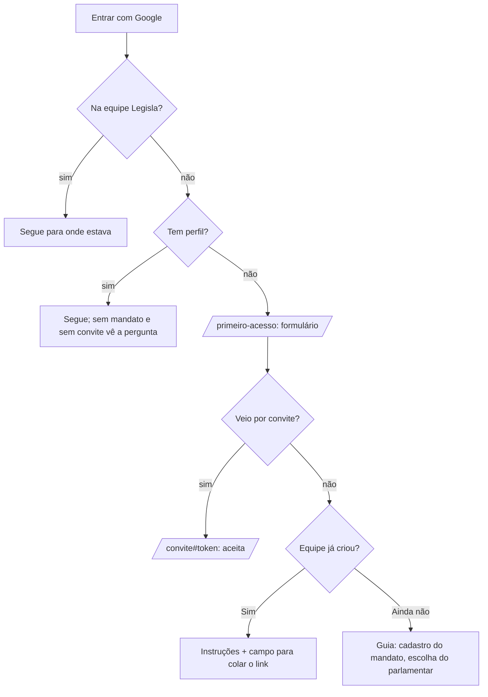

# Primeiro Acesso e Login só com Google Design

**Spec**: `.specs/features/primeiro-acesso-google/spec.md`
**Status**: Draft

---

## Architecture Overview

Uma página nova do app Next.js, `/primeiro-acesso`, concentra o perfil, a pergunta "sua equipe já criou?" e as instruções do link. As três entradas (Guia, `/mandato`, `/convite`) não têm formulário de perfil próprio: quando a pessoa não tem perfil, mandam para `/primeiro-acesso` e a página devolve a pessoa ao ponto de partida. O banco guarda o perfil em `public.perfis`, grava por uma função e bloqueia, nas duas portas de entrada em um mandato (aceitar convite e criar mandato), quem ainda não tem perfil.



Decisões de arquitetura:

- **Uma página, três entradas.** A regra "tem perfil?" vive em uma função pura (`lib/perfil/fluxo.ts`) e em uma consulta (`lib/perfil/api.ts`), usadas por `/mandato`, `/convite` e `/primeiro-acesso`. O Guia legado (AD-003: `app.js` e `nucleo.js` não se editam à mão) usa um override em `public/legacy/acesso.js` que chama a mesma consulta pela API REST do Guia (`Nuvem.rest`).
- **Gravação por função, não por insert.** `perfil_salvar(...)` valida, grava o perfil e o consentimento na mesma transação e é idempotente. `authenticated` não tem `insert`, `update` nem `delete` em `perfis`.
- **O banco barra as duas portas.** `convite_aceitar` devolve `{ok:false, erro:'perfil'}` e a política `mandatos_criar` exige perfil, exceto para `equipe_legisla`. A tela só dá o caminho; quem pular a tela encontra a recusa.
- **Convite resolve o perfil sozinho.** O `/convite` não pergunta nada de perfil: tenta aceitar, recebe `erro:'perfil'`, guarda o token no `sessionStorage` (já existe, `lib/convites/pendente.ts`) e vai a `/primeiro-acesso?volta=convite`. Ao terminar o perfil a página reabre `/convite#<token>`.
- **A pergunta "sua equipe já criou?" só aparece sem mandato e sem convite.** "Ainda não" grava a marca `legisla.semEquipe=1` no `sessionStorage` e abre `/guia`; o override do Guia só abre o cadastro de mandato com a marca presente. Sem a marca e sem mandato, o Guia manda para `/primeiro-acesso`.
- **Analytics por função agregada.** `admin_perfil_resumo()` devolve só contagens em um `jsonb`; a seção do `/admin` desenha os gráficos com o `Grafico` existente.
- **Login só com Google.** Os três formulários de senha saem. No Guia, o override esconde os campos e faz `Store.criarConta` e `Store.entrar` recusarem sem chamada de rede.

---

## Code Reuse Analysis

### Existing Components to Leverage

| Component | Location | How to Use |
| --------- | -------- | ---------- |
| `urlGoogle`, `lerRetornoGoogle`, `gravaSessao`, `lerSessao`, `renova` | `plataforma/lib/admin/sessao.ts` | Login Google e sessão em `legisla.tok`; `entraComSenha` sai |
| `criaApi`, `lerTudo` | `plataforma/lib/admin/api.ts` | Cliente REST/RPC das páginas novas |
| `criaAutenticada` | `plataforma/app/mandato/sessaoApi.ts` | Sessão com renovação em `/primeiro-acesso` |
| `guardaPendente`, `lePendente`, `limpaPendente` | `plataforma/lib/convites/pendente.ts` | Guardar o token do convite durante o perfil |
| `AvisoConsentimento`, `CaixaConsentimento` | `plataforma/app/convite/FormularioConta.tsx` | Aviso geral da LGPD dentro do formulário de perfil |
| `Grafico` | `plataforma/app/admin/_componentes/Grafico.tsx` | Gráficos da seção de perfil |
| `private.eh_legisla()` | `20261016120000_schema_inicial.sql` | Leitura do perfil e função de resumo |
| Molde de função `jsonb` com erro como dado | `20261106150000_convites_de_quem_sai.sql` | `perfil_salvar` e a recusa `perfil` do aceite |
| `sql-ambiente.ts` (PGlite) | `plataforma/tests/sql-ambiente.ts` | Testes de SQL com as migrations reais |

### Integration Points

| System | Integration Method |
| ------ | ------------------ |
| Supabase Auth (Google) | Mesmo fluxo de hoje; nada novo no Supabase |
| `consentimentos` | `perfil_salvar` grava uma linha de versão `2026-11`, que também satisfaz a checagem de consentimento do aceite de convite |
| `convite_aceitar` | Recebe a checagem de perfil logo depois da de consentimento (copiar a versão de `20261106150000` e acrescentar só isso) |
| `excluir_meus_dados` | Passa a apagar `perfis` (copiar a versão de `20261106150000`) |

---

## Components

### Migration `20261109120000_perfis.sql`

- Tabela `public.perfis` (modelo abaixo), RLS ligada, política `perfis_ler` (`user_id = auth.uid()` ou `private.eh_legisla()`), sem política de escrita.
- `revoke all` de `anon` e `authenticated` na tabela e `grant select` só a `authenticated`.
- `public.perfil_salvar(p_nome, p_nascimento, p_genero, p_raca, p_telefone, p_atua, p_tempo)` retorna `jsonb`: `{ok:true}` ou `{ok:false, erro:<campo>}`. Valida o mesmo que a spec (PAG-02.9 a 02.11, PAG-03.7, 03.8), grava `perfis` e `consentimentos` (versão `2026-11`) na mesma transação e, se a pessoa já tem perfil, devolve `{ok:true}` sem mudar nada (PAG-02.14).
- `private.tem_perfil()`: `true` para quem está em `equipe_legisla` ou tem linha em `perfis`.
- `convite_aceitar`: depois da checagem de consentimento, `if not private.tem_perfil() then return {ok:false, erro:'perfil'}`.
- Política `mandatos_criar`: `criado_por = auth.uid() and private.tem_perfil()`.
- `excluir_meus_dados`: acrescenta `delete from public.perfis where user_id = auth.uid()`.

### Migration `20261109130000_perfil_resumo.sql`

`public.admin_perfil_resumo()` retorna `jsonb` `{total, por_mes:[{mes,qtd}], genero:{rotulo:qtd}, raca:{}, faixa:{}, atuacao:{}}`. Exige `private.eh_legisla()`; sem isso levanta erro de permissão. Faixa etária por `age(current_date at time zone 'America/Sao_Paulo', nascimento)`. `por_mes` vai do mês do primeiro perfil ao atual, no máximo 12. Nenhuma coluna individual sai da função.

### `lib/perfil/` (funções puras, `node --test`)

| Arquivo | Conteúdo |
| ------- | -------- |
| `opcoes.ts` | Listas e rótulos: gênero (8), raça (6), atuação (`nao_atua`, `menos_1`, `1_2`, `3_5`, `6_10`, `mais_10`); chave interna e rótulo de cada |
| `validacao.ts` | `validaPerfil(dados)` devolve `{ok:true, dados}` ou `{ok:false, erro, campo}` com os textos literais da spec; normaliza o telefone para só dígitos |
| `fluxo.ts` | `proximoPasso({temPerfil, ehLegisla, temMandato, veioPorConvite, semEquipe})` retorna `'seguir' \| 'perfil' \| 'pergunta' \| 'cadastroMandato'` |
| `api.ts` | `meuPerfil`, `ehEquipeLegisla`, `perfilSalvar` (nomes dos argumentos `p_*`, tradução do retorno) |
| `link.ts` | `tokenDoLinkColado(texto)` reaproveita `tokenDoHash`; devolve `null` se não for convite |

### `app/primeiro-acesso/` (e2e Playwright, Supabase interceptado)

`page.tsx` + `PrimeiroAcesso.tsx` com estados `carregando`, `entrada` (só "Entrar com Google"), `perfil`, `pergunta`, `instrucoes`, `erro`. Parâmetro `volta` (`guia`, `mandato`, `convite`). O formulário traz `AvisoConsentimento`, a caixa geral e a caixa específica dos dados sensíveis (texto de PAG, revisão jurídica pendente), o nome vindo do Google, e os campos da spec com `Prefiro não informar` onde a spec manda.

### `/mandato` e `/convite`

- `Casca.tsx`: depois de `sessao.usuario()`, consulta equipe Legisla e perfil; sem perfil, `location.replace('/primeiro-acesso?volta=mandato')`.
- `Convite.tsx`: `aceitaComSessao` trata `erro:'perfil'`: `guardaPendente`, `location.replace('/primeiro-acesso?volta=convite')`.
- `lib/convites/erros.ts`: sai `email_not_confirmed`; entra o código `perfil` (sem mensagem própria: nunca chega à pessoa).

### Guia legado (`public/legacy/acesso.js`, `lib/legacyBody.ts`)

- Override de `App.entrou`: antes de `meusMandatos`, consulta equipe Legisla e perfil; sem perfil, `location.replace('/primeiro-acesso?volta=guia')`. Sem mandato: marca `legisla.semEquipe` presente abre `Telas.primeiroAcesso()`; ausente manda para `/primeiro-acesso`.
- `Store.criarConta` e `Store.entrar` sobrescritos para lançar `Error('Entre com o Google.')`; a tela de entrada perde os campos de e-mail, senha, nome e as abas, e fica só com "Entrar com Google" e o aviso de LGPD.

### `/admin`

- `Sessao.tsx`: sai o formulário de senha; fica o botão do Google. `lib/admin/sessao.ts` perde `entraComSenha`.
- `analytics/page.tsx` monta a seção `SecaoPerfil` com `rpc('admin_perfil_resumo')`; `lib/admin/perfil.ts` (função pura) transforma o `jsonb` em categorias com número e porcentagem inteira e ordena as faixas etárias.

### Convite (`FormularioConta.tsx`)

Reduzido ao botão "Entrar com Google" que guarda o token pendente e sai para o Google. `criaConta`, `entrar`, `CONFIRME_EMAIL` e as abas saem. `AvisoConsentimento` e `CaixaConsentimento` continuam exportados (o perfil os usa).

---

## Data Models

```sql
create table public.perfis (
  user_id     uuid primary key references auth.users on delete cascade,
  nome        text not null check (char_length(nome) between 2 and 120 and nome ~ '\S+\s+\S+'),
  nascimento  date not null check (nascimento >= date '1900-01-01'),
  genero      text not null check (genero in ('mulher_cis','homem_cis','mulher_trans','homem_trans','travesti','nao_binaria','outra','nao_informar')),
  raca        text not null check (raca in ('branca','preta','parda','amarela','indigena','nao_informar')),
  telefone    text not null check (telefone ~ '^(1[1-9]|[2-9][0-9])[0-9]{8,9}$'),
  atua        boolean not null,
  tempo       text check (tempo in ('menos_1','1_2','3_5','6_10','mais_10')),
  criado_em   timestamptz not null default now(),
  check ((atua and tempo is not null) or (not atua and tempo is null))
);
```

`current_date` não é imutável e não entra em `check`; a recusa de data futura (PAG-02.10) fica em `perfil_salvar`, e o `check` guarda só o piso de 1900-01-01.

---

## Error Handling Strategy

| Error Scenario | Handling | User Impact |
| -------------- | -------- | ----------- |
| Campo inválido no formulário | `validaPerfil` recusa antes da chamada; o banco repete a regra | Mensagem literal da spec; dados mantidos |
| `perfil_salvar` falha (rede, 5xx) | Tela mostra "Não foi possível salvar. Tente de novo." | Pode repetir; a função é idempotente |
| Aceite devolve `erro:'perfil'` | Token guardado, redireciona ao perfil | A pessoa preenche e volta ao convite |
| Guia sem sessão, sem rede ou consulta de perfil falha | O Guia segue para a entrada ou mostra o erro que já mostra; não assume "sem perfil" por falha | Evita mandar quem já tem perfil ao formulário por engano |
| `admin_perfil_resumo` falha | Seção mostra "Não foi possível carregar o perfil. Tente de novo."; o resto do Analytics segue | Sem tela quebrada |
| Chamada da função de resumo por quem não é da Legisla | Erro de permissão do banco | Seção de erro |

---

## Risks & Concerns

| Risk | Impacto | Mitigação |
| ---- | ------- | --------- |
| Os testes de SQL e e2e existentes criam mandatos e aceitam convites com contas sem perfil | A trava do banco os quebra | Helper `comPerfil(uid)` em `sql-ambiente.ts` e nos mocks e2e; ajuste mínimo, sem enfraquecer teste algum |
| `convite_aceitar` e `excluir_meus_dados` já foram redefinidas 3 vezes | Copiar a versão errada reverte regras de segurança | Copiar a versão de `20261106150000`; o teste existente de cada função continua passando |
| O Guia legado é extraído por script | Editar `app.js` ou `nucleo.js` à mão se perde na próxima extração (AD-003) | Só `acesso.js` e `legacyBody.ts`; `legado-acesso.test.ts` cobre |
| Texto do consentimento de dados sensíveis sem revisão jurídica | Risco de LGPD | Texto marcado como provisório; revisão da Legisla antes de publicar |
| Sessão do navegador (`sessionStorage`) perde o token se a pessoa trocar de aba no meio do perfil | Pessoa volta ao `/convite` sem o token e vê a tela de colar o link | Aceito: a tela de colar já existe; registrado como limitação |
| Contas que existiam com senha | Nenhuma (todas são Google, informação do usuário) | Conferir no banco antes de publicar (só leitura) |
| `painel.html` (`/painel`, painel antigo) tem login próprio | Fora das três entradas da spec | Fica como está; registrado em STATE.md |

---

## Tech Decisions (only non-obvious ones)

| Decision | Choice | Rationale |
| -------- | ------ | --------- |
| Onde mora o formulário | Uma página nova, não dentro do Guia | O Guia legado não se edita à mão; uma página React é testável com Playwright |
| Como bloquear | UI manda para o perfil, banco barra as duas portas | A UI sozinha se contorna; o banco sozinho dá erro sem caminho |
| Erro de perfil no aceite | `erro:'perfil'` como dado, como `consentimento` | Mesmo padrão do aceite hoje; a tela decide o destino |
| Consentimento do perfil | Uma linha em `consentimentos` com versão `2026-11` | Reaproveita a tabela e a checagem do aceite |
| Estado de "Ainda não" | `sessionStorage` (`legisla.semEquipe`) | Vale só para esta sessão; sem coluna nova |
| Faixa etária | Calculada no banco na hora da consulta | Não envelhece nem guarda dado derivado |
