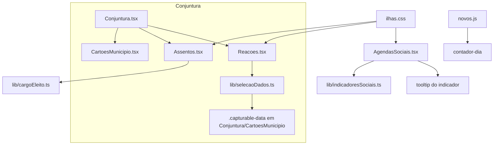

# Sugestões do Pedro (11/11/2026) Design

**Spec**: `.specs/features/sugestoes-pedro-1111/spec.md`
**Status**: Draft

---

## Architecture Overview

Tudo é ajuste dentro das ilhas React da Missão 1 e do CSS escrito à mão (`ilhas.css`), mais um override no `novos.js` para o contador. Nenhuma mudança de schema e nenhum arquivo extraído do Guia (`conteudo.js`, `app.js`, `legacy.css`) é editado (CLAUDE.md: seriam sobrescritos pela extração). Regra de negócio nova entra em `lib/` como função pura (AD-004).

## Code Reuse Analysis

| Component | Location | How to Use |
|---|---|---|
| `DadoPartido`, `defineReacao`, `frase` | `lib/dadosPartido.ts` | A seleção por clique chama `defineReacao` com o mesmo `DadoPartido`; o formato gravado em `D.conj2.reacoes` não muda. |
| `useLegado().bump()` | `ilhas/ponte.tsx` | Gravar a seleção como já se grava hoje. |
| `FAIXAS`, `faixaDe` | `lib/agendas.ts` | Fonte das cores/rótulos dos selos (OP-02). |
| `IndInfo.fonte/ano/sentido` | `lib/agendas.ts:39` | Conteúdo do tooltip (OP-04). |
| `Slides` | `ilhas/Slides.tsx` | Mantido; só a altura/rolagem do cartão muda. |
| `CATEGORIAS`, `statusDe` | `lib/relacoes.ts` (via Assentos) | O controle compacto reaproveita as 5 categorias. |
| `.abas` | `legacy.css:319` | Override em `ilhas.css` (`overflow-y:hidden`). |

### Integration Points

| System | Integration Method |
|---|---|
| `mandatos.dados` (jsonb) | Sem campo novo: `D.conj2.reacoes` e `D.conj2.prefExtra` seguem iguais. |
| Resumo da Missão 1 | O Resumo lê `D.conj2.reacoes`; como o formato é o mesmo, não muda. |

## Components

### cargoEleito (função pura)
- **Purpose**: Cargo no feminino ou masculino conforme gênero e casa.
- **Location**: `plataforma/lib/cargoEleito.ts`
- **Interfaces**: `cargoEleito(e: { k: string; uf: string; g?: string }): string`
- **Dependencies**: nenhuma. **Reuses**: a lógica de `cargoDe` em `Assentos.tsx:19`.

### Seleção visual de dados
- **Purpose**: Máquina de estados da captura (ociosa → aguardando 1º → aguardando 2º → concluída) sem DOM.
- **Location**: `plataforma/lib/selecaoDados.ts`
- **Interfaces**:
  - `proximo(e: Estado, ev: Evento): Estado` — eventos `iniciar`, `capturar(dado)`, `cancelar`, `remover(i)`.
  - `mensagem(e: Estado): string` — texto do banner por etapa.
- **Dependencies**: `DadoPartido`. **Reuses**: `defineReacao`.

### ModoCaptura (ilha)
- **Purpose**: Banner fixo, escuta de cliques em `.capturable-data`, tags 1️⃣/2️⃣, scroll de volta ao formulário.
- **Location**: `plataforma/ilhas/Reacoes.tsx` (substitui os `<select>`) e `plataforma/public/legacy/ilhas.css`.
- **Interfaces**: cada elemento capturável carrega `data-dado-id`, `data-dado-nome`, `data-dado-valor`; o ouvinte usa delegação de eventos no documento (um `click` em fase de captura) e só vale com o modo ativo.
- **Dependencies**: `selecaoDados`, `DadoPartido`. **Reuses**: o formato de `dados` já montado pela Conjuntura.

### Cartão de parlamentar compacto
- **Purpose**: Relação atual uma vez + controle de troca (popover/`select` nativo).
- **Location**: `plataforma/ilhas/Assentos.tsx`
- **Reuses**: `CATEGORIAS`. Escolha: `select` nativo estilizado (acessível e simples no celular) em vez de popover próprio.

### Tooltip de indicador
- **Purpose**: ⓘ com fonte, ano e sentido.
- **Location**: `plataforma/ilhas/AgendasSociais.tsx` + `lib/indicadoresSociais.ts` (`descreveIndicador(i: IndInfo): string`, pura).
- **Reuses**: `IndInfo`. Acessível por foco (`aria-describedby`), não só hover.

## Data Models

Sem modelo novo. `Reacao { dado, valor, texto }` e `D.conj2.prefExtra` permanecem.

## Error Handling Strategy

| Scenario | Handling | User Impact |
|---|---|---|
| Clique em elemento sem `data-dado-*` no modo captura | Ignorado | Nada acontece; o banner segue. |
| Mesmo dado clicado duas vezes | Segundo clique ignorado com aviso no banner | "Escolha um indicador diferente." |
| `Esc` ou [Cancelar] no meio da captura | Estado volta a ociosa; dado 1 já capturado é mantido só se o 2º foi concluído | Banner some, nada é gravado pela metade. |
| Indicador sem `fonte` | Tooltip mostra só o que existe | Sem texto vazio. |

## Risks & Concerns

| Concern | Location | Impact | Mitigation |
|---|---|---|---|
| Os `<select>` de Dado 1/2 e o `Resumo` dependem do mesmo `dados` montado na Conjuntura | `ilhas/Reacoes.tsx:32`, `ilhas/Conjuntura.tsx` | Trocar a origem do dado pode dessincronizar o Resumo | O formato de `D.conj2.reacoes` não muda; e2e confere o Resumo após a captura. |
| Delegação de clique global pode capturar cliques de outras ilhas | modo captura | Clique em botão alheio vira "dado" | Só elementos com `.capturable-data`; botões e links dentro deles têm `stopPropagation` no modo ativo. |
| `legacy.css` e `app.js` são extraídos | `legacy.css:319`, `app.js:93` | Edição direta é apagada na próxima extração | Correções em `ilhas.css` e `novos.js` (hand-written). |
| Causa do #139.1 (botão sobre o texto, caixa cortada) não confirmada | cabeçalho/rodapé da área de parlamentares | Correção errada | T6 reproduz em 1280px e 390px antes de corrigir; sem repro, registra e devolve ao Pedro. |
| Testes e2e usam Supabase interceptado | `e2e/m1-*.spec.ts` | Specs existentes podem referir a "Prefeituras que a liderança acompanha" e ao `<select>` | T7 e T13 atualizam os specs afetados no mesmo commit. |

## Tech Decisions

| Decision | Choice | Rationale |
|---|---|---|
| Seleção visual | Delegação de clique + classe `.capturable-data` com `data-dado-*` | Não obriga cada card a conhecer o modo de captura. |
| Troca de relação | `select` nativo no cartão | Resolve o ruído visual (PAR-02) sem popover novo. |
| Contador > 100 | Mostrar `100+` com texto "dia de 100" trocado por "100 dias concluídos" | A data é correta; o rótulo é que não faz sentido. Confirmar (Assumption 1). |
| Tooltip | Conteúdo derivado do catálogo | Evita inventar conceito por indicador. |
